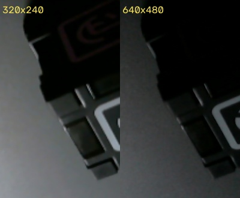

# C270 resolution crossover with four simultaneous cameras

Four passive ten-second captures requested 5 fps YUYV from the C270, 720p MJPEG at 30 fps from the twins and 720p MJPEG at 15 fps from Arducam. The C270 resolution sequence was 320×240, 640×480, 640×480, 320×240. Streams ran independently for the entire trial. The four-way common packet timestamp intervals span 7.61–8.69 s.

The C270 containers each held 40 packets with zero empty packets. Every one of the 155 C270 packets inside the four common intervals had exactly two bytes per image pixel. In the earlier stationary recording 12 of 30 packets at 640×480 were empty. That failure did not recur at either resolution here. Both settings still clip the cube glyph. Retain the higher-resolution setting for detail, and check actual payload sizes on each capture.

Arducam varied from 5.52 to 20.05 nonempty packets/s in the shared intervals. Its slowest run and one of its fastest runs both used the low C270 resolution. A full-frame C270 stream therefore does not establish that all cameras sustained their requested rates. MJPEG counts in this comparison indicate nonempty packets; they do not verify JPEG decode. Twins delivered 18.14–18.55 and 24.93–26.08 nonempty packets/s. No robot, lamp or cube commands were issued.

[Counts and packet gaps](streams.csv) · [scoring script](score.py) · [earlier stationary test](../README.md).

