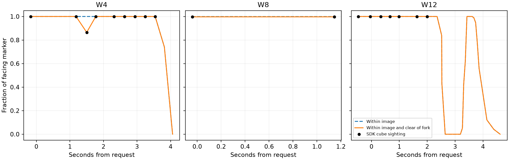
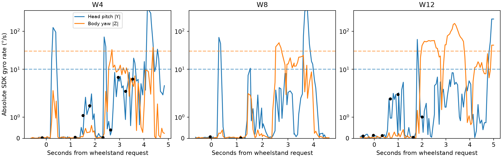

# Fork visibility during physical wheelstand approaches

In W12 the SDK last reported the cube 2.00 s after the wheelstand request. All 289 rays to the facing 23 mm marker were inside the image and clear of the modeled printed fork at that observation. They remained clear and inside through 2.35 s. The modeled marker first left the frame completely at 2.64 s, re-entered fully by 3.42 s, and was outside again at the last sampled image (4.62 s). The first recorded cube tap followed at 4.92 s. The fork intercepted zero sampled in-frame rays throughout W12 for either tested marker width.

W4 provides a positive check on the occlusion calculation. The fork intercepted 13.5% of the 23 mm marker grid at a **reported** sighting while the lift passed 48 mm. The corresponding estimate for a 20 mm marker was 7.6%. W8 had just six image stamps before its early first tap, and no more than one of the 289 rays was intercepted at a given stamp. A rule suppressing detections whenever the fork overlaps a marker would lose a real W4 detection and would leave the W12 gap unexplained.

## Measurement

The replay uses the calibrated moving head camera, SDK body quaternion, head and lift encoders, and the registered forks7 collision geometry (58 convex pieces). A uniform 17 × 17 grid covers the most camera-facing vertical cube marker at an assumed 22 mm from the cube centre. Fractions describe sampled marker surface area. The 20 and 23 mm widths bracket the earlier marker-size hypotheses. The assumed complete printed fork can overestimate occlusion on the unit with a missing tooth. This measures fork intersections only. Exposure, blur, the other robot surfaces and the SDK vision schedule remain outside the calculation.

A dot identifies an SDK cube event with exactly the robot state's last-image timestamp. The other samples show image stamps for which the log has no matching cube event. The physical cube pose is held at its latest reported value in the same origin; the CSV includes its age. Real movement before the first tap remains possible. Host receipt times are relative to the wheelstand command. These SDK logs do not supply independent video labels for the unsighted intervals.

Run `python replay.py PATH_TO_FORK_FIXTURE.xml` in this directory. Use the same registered 58-piece fixture as the W4 contact replay. The three compressed CSVs contain the replay inputs; `extract.py LOG_DIRECTORY` rebuilds them from the original SDK logs.

## Why a visible cube can stop producing sightings

The public stock vision code checks the IMU at the image timestamp before marker detection. Its default limits for blocks are absolute head pitch rate above 10°/s or absolute body yaw rate above 30°/s. Either adjacent native IMU sample can suppress processing. The fast-rotation vision mode bypasses this check; the markers-off mode disables detection outright. [Marker update](https://github.com/kercre123/victor/blob/669ec7499a7084640b57706a7937884a6568be50/engine/vision/visionSystem.cpp#L1575-L1603) · [IMU tests](https://github.com/kercre123/victor/blob/669ec7499a7084640b57706a7937884a6568be50/engine/components/sensors/imuComponent.cpp#L156-L215)

After W12's last sighting, nine sampled images still had the entire facing marker within frame and clear of the modeled fork. All nine coincided with SDK yaw-rate brackets above the stock threshold (54–140°/s). At eight of nine, a motion limit remained exceeded at every tested timing shift (−120, −60, 0, +60, +120 ms). Head pitch alone would miss the effect. This gives a firmware-supported explanation for the gap before frame clipping and again during re-entry.

The comparison uses adjacent SDK gyro readings around host receipt, not the native IMU pair at exposure. At nominal timing it also flags two actual sightings out of 18 across W4, W8 and W12. Both depend on the assumed alignment. The logs omit per-frame vision-mode selections. A hard veto based on SDK receipt times would therefore introduce false negatives. Black points are reported cube sightings. Run `python motion_gate.py` to reproduce the plot and per-image sensitivity table.
