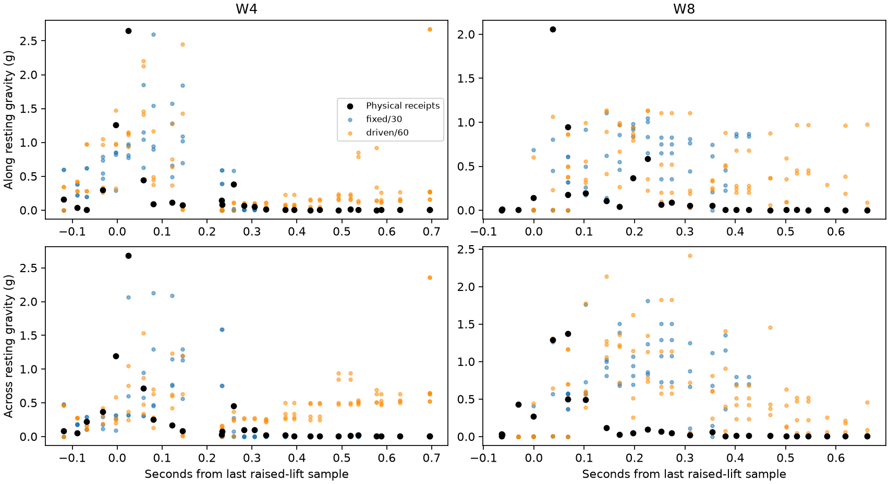

# Wheelstand contact against measured cube acceleration

The fixed rear supports with a 30 mN·m lift cap gave the smallest mean error on W4 for both acceleration components at the recorded receipt times. That choice also ranked first on W8 without refitting, but underpredicted its peak along resting gravity in every timing case: **0.84–1.11 g simulated versus 2.06 g observed**.

| Rear supports / lift cap | W4 along / across error (g) | W8 along / across error (g) |
|---|---:|---:|
| Fixed / 30 mN·m | 0.312 / 0.298 | 0.300 / 0.437 |
| Fixed / 60 mN·m | 0.350 / 0.333 | 0.406 / 0.541 |
| Driven / 30 mN·m | 0.366 / 0.368 | 0.502 / 0.562 |
| Driven / 60 mN·m | 0.396 / 0.463 | 0.387 / 0.518 |

Each dot uses one packet's largest absolute component along the cube's resting acceleration vector or its largest perpendicular magnitude. The peaks can be in different slots. These are sensor-frame components: cube rotation can change the gravity projection. Neither axis estimates fork force directly. The figure shows the two endpoint configurations and the table includes all four.

The score averages absolute packet errors, then weights the four pre-existing release/descent cases equally. All cases use the same 28 physical W4 and 27 W8 packet receipts from 140 ms before to 800 ms after the last raised-lift sample. Shading marks intervals between receipts longer than 150 ms. The nearest simulated packet is compared at each physical timestamp. Intermediate physical samples are unknown. No gain, clock, contact parameter or starting pose was fitted to W8.

Shifting the lookup by ±30 ms kept fixed/30 first on W8. On W4 a +30 ms lookup favored fixed/60, so this comparison supports the fixed-support choice more consistently than a specific torque cap. The rankings describe these two wheelstands; they are insufficient to change a general robot default. [All timing cases and sensitivity scores](acceleration-receipts.csv)

Run `python acceleration_receipts.py fixture.xml` using the existing [wheelstand replay environment](contact-events.md), with MuJoCo 4.0.1 and the 58-piece fork fixture.
