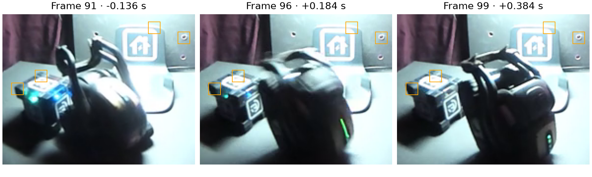
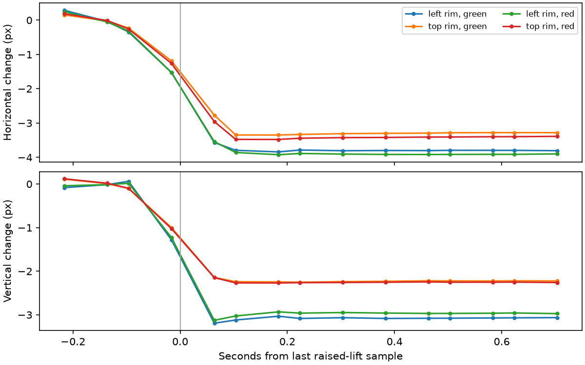

# In W8 the visible cube settles early in the climb

The left rim of the physical cube moved about 3.9 pixels left and 3.0 pixels up from frame 91 to the held posture. Most of that shift was already visible in frame 94, about 64 ms after the last raised-lift observation. In frames 95–98 (+104 to +304 ms), as the chassis rose to its measured peak, the two cube patches each varied by less than 0.10 px per image axis in both the red and green channels. This last number describes sampled patch positions; it is not a bound on motion between frames or along the line of sight.

The chassis obscures the rear hub centre from this rear-quarter view. The illuminated strip on the rear rotates with the chassis, so treating it as an axle marker would turn pitch into apparent axle travel. This movie supports an independent cube image track. It does not establish rear axle travel in millimetres.

Two 13×13 px patches on the cube were matched independently in red and green to frame 91. The plotted displacement subtracts the mean of the dock-outline and wall-screw displacements. Their tracks disagreed by at most 0.07 px. The [previous visual time anchor](early-cube-track.md) places movie frame 86 at command +3.065 s. The short interval includes only four captured frames, and the alignment inherits uncertainty from that single anchor.

In the [encoder-conditioned simulation](wheel-authority.md), the two releases gave materially different cube motion during those same 200 ms. The range of the simulated top centre's horizontal distance from its starting reference was 1.48 versus 8.84 mm; cube yaw spanned 0.17° versus 4.34°. Both simulated chassis continued climbing. The physical patches supply a timing constraint on visible motion. Ranking the releases quantitatively requires projecting their cube corners into this camera; image pixels and simulation millimetres cannot be compared directly.

[Physical tracks and correlations](ascent-cube.csv) · [Replay measurements](ascent-cube-replay.csv) · [Camera tracking](ascent_cube.py) · [Simulation script](ascent_cube_replay.py)
