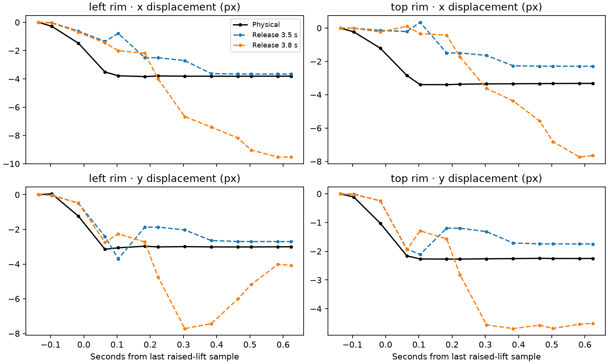

# The W8 movie favors the earlier simulated release

The two candidate releases use the same physical wheel-speed and lift inputs. The earlier release tracks the physical cube rims more closely in all 18 paired camera, landmark-height and time-shift checks, both across the full sequence and during the four-frame ascent interval. This identifies the better of these two starting conditions for W8; neither reproduces the nearly stationary physical patches during ascent.

| Scored movie frames | Earlier release RMS (px) | Later release RMS (px) |
|---|---:|---:|
| 91–103, initial motion through hold | 1.68 | 3.70 |
| 95–98, ascent after the cube's initial shift | 2.28 | 3.85 |

The table and plot use the 675 native-pixel focal fit, 44 mm patch height and original video alignment. The score is radial RMS over both patches and all subsequent frames after subtracting the first displacement in the scored window. The plot uses only the frame-91 reference. For the full sequence the errors across sensitivity checks were 1.47–2.19 px versus 2.55–3.84 px. For frames 95–98 they were 0.70–2.28 px versus 1.73–4.94 px. The checks reuse one recording.

## Registration

The [dock-outline fit](dock-outline.md) supplies the camera pose. The precontact fork and roof determine which way the SDK frame points in dock coordinates. At frame 91, the cube top centre is placed at an approximate movie pick (322,337) at 44 mm above the shelf. Each observed patch is back-projected to a horizontal plane and attached at that point to the simulated rigid cube. The code checks that both initial points reproject to their original pixels. Subsequent predictions use the full cube rotation and translation from the bounded wheel-velocity and lift replay. No subsequent image coordinates enter the simulation.

We tested focal lengths of 670, 675 and 695 native pixels, landmark heights of 38 and 44 mm, and camera time shifts of −40, 0 and +40 ms. The observed displacements average the red and green image estimates after subtracting the stationary dock and wall motion. The small cube-centre pick, reference orientation and heading were held fixed, so this is a conditional ranking. The release labels 3.5 and 3.8 s use the W4 replay clock convention.

[Paired sensitivity results](ascent-projection.csv) · [Reproduction script](ascent_projection.py) · [Physical patches and recording](ascent-cube.md)
