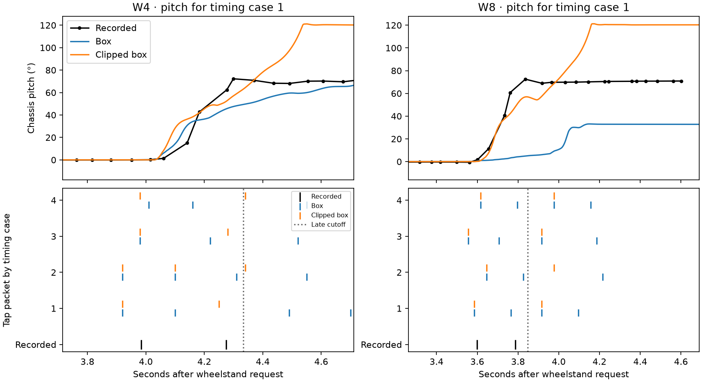
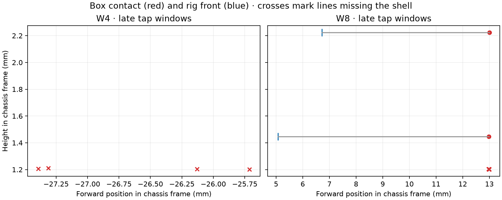

# Does the chassis box explain the extra wheelstand taps?

The collision box supports the simulated cube where the registered animation rig has little or no fixed chassis material. Replacing those parts of the box reduces late taps in both recordings. It also lets the simulated robot roll past the roughly 70° wheelstand observed on both physical runs.

| Run | Late taps, box → clipped | Median held pitch, box → clipped |
|---|---:|---:|
| W4 | 5 → 2 | 59.3° → 120.1° |
| W8 | 7 → 4 | 32.3° → 100.2° |

For each late packet, we selected the single strongest load-bearing chassis–cube contact in the preceding 30 ms and transformed its midpoint into chassis coordinates. On W8, six of seven windows had such a contact, all within 0.04 mm of the x = 13 mm front face. A fore-aft line through four of the six missed the fixed rig shell. In the other two, the simulation contact lay 6.29 and 7.90 mm forward of the foremost triangle at that lateral position and height. On W4 the four loaded windows clustered at the side and underside, and each line missed the fixed shell. The stock animation rig is an independent geometry reference. The test excludes the moving head, links, wheels and treads from the fixed-shell comparison. Millimetres here describe model geometry. The physical fork–cube and chassis–cube contact points were unmeasured.

The intervention intersects the existing box with the registered fixed shell's convex envelope in three dimensions. A convex envelope can bridge recessed areas. Other collision shapes and the explicit chassis inertia, fork, drive and controller settings are identical across variants. Each condition covers four timing assumptions on one physical recording. The two recordings were already examined during the preceding contact diagnosis. The counts sum simulated packet changes over the four cases, using the prior observation windows and 60 ms late cutoff. All four clipped W8 cases still produced one late tap and passed 120° peak pitch. This proxy should stay experimental.

To reproduce, fetch the [pinned stock rig](../../../simulacrum/body_mesh.py) with the module's fetch command, then run both scripts with the original fixture path and the rig OBJ path as positional arguments. Use the [baseline replay environment and fixture](contact-events.md) and install SciPy for convex clipping. [Local contact coordinates](chassis-patch.csv) · [Per-case outcomes](clipped-chassis.csv)
