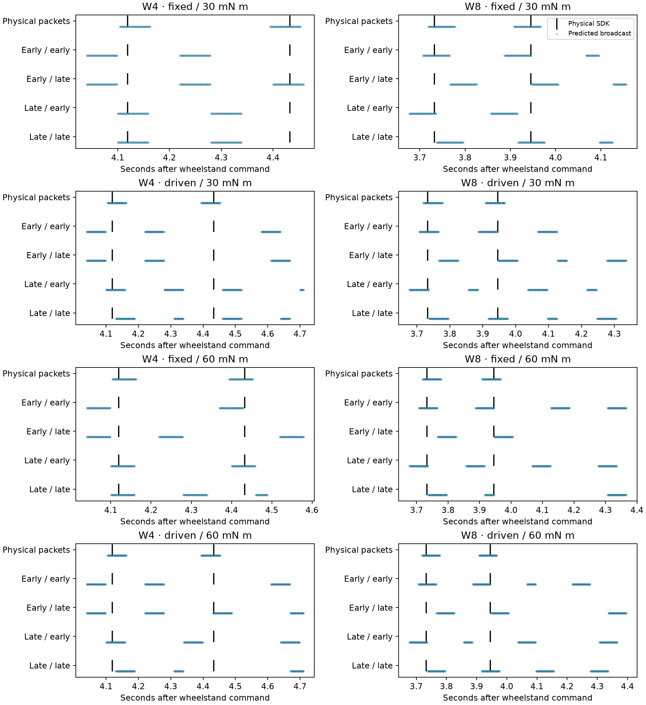

# From wheelstand contact to cube tap broadcasts

Both physical wheelstands generated two cube tap-counter changes and two SDK callbacks during the contact window. With the measured packet changes as input, the simulator's physical-engine tap filter also produced two callbacks at every tested phase. Starting instead from simulated fork, tread and cube contact changed the result substantially.

| Rear support / lift cap | W4 cases with two broadcasts | Held-out W8 cases with two broadcasts |
|---|---:|---:|
| Fixed / 30 mN m | 180 / 240 | 150 / 240 |
| Driven / 30 mN m | 0 / 240 | 30 / 240 |
| Fixed / 60 mN m | 150 / 240 | 90 / 240 |
| Driven / 60 mN m | 12 / 240 | 0 / 240 |

Each denominator is four release/onset combinations × 60 integer-ms phases of the 60 ms engine clock. These are sensitivity cases from one recording per column. Matching the count alone can hide a substantial timing error. On W8 the driven/60 model generated three or four callbacks throughout. Its last callback was 272–451 ms later than the last recorded SDK tap. The matching physical-packet control was within −37 to +22 ms. The discrepancy already exists upstream of SDK publication.

The black ticks mark SDK receipt times. The blue bands cover publication times as the engine phase varies. The top line in every panel uses the physical packet counter. The remaining lines use MuJoCo contacts feeding the simulated cube chip, firmware tap detector and engine broadcast filter. W4 uses its recorded SDK cube pose and W8 its camera-registered cube pose. The window starts 0.3 s before the last raised-lift observation and ends at the earlier of 1.2 s later or the last recorded cube packet. Broadcasts after this boundary are excluded in all cases. Simulated approach states come from the existing finite-actuator replay and the sensor seed is 17. The simulator has no independent estimate of host callback latency.

## Shell-contact sensitivity

Using the frozen driven/60 configuration, change only the free cube's plastic-shell contact time constant from 4 ms to 20 ms. The rubber corner pads retain their own 8 ms contact response. On MuJoCo 4.0.1 the medians across the four initializations were:

| Trial | Shell response | Peak pitch | Held pitch | Cube peak acceleration |
|---|---:|---:|---:|---:|
| W4 physical | | 72.25° | 70.14° | 4.50 g |
| W4 | 4 ms | 121.22° | 59.26° | 3.62 g |
| W4 | 20 ms | 52.60° | 51.81° | 2.32 g |
| W8 physical | | 72.50° | 70.15° | 2.36 g |
| W8 | 4 ms | 33.54° | 32.35° | 2.13 g |
| W8 | 20 ms | 33.48° | 18.77° | 3.22 g |

The softer response removed the median W4 overshoot and increased the held-angle deficit on both runs. The W8 median packet-change count stayed at four. On 3.11.0, the W4 median stayed above 121° at both shell settings, so the W4 peak response to this change is solver-version dependent. The data give no basis for adopting 20 ms as a general correction. The existing optional wheelstand regression with the exact printed-fork fixture failed two assertions on 4.0.1 (W8 driven-support peak and W4 median peak error) and one on 3.11.0 (W4 median peak error). The determinism test passed on both versions; the pre-existing physical-match expected failure remained. The historical commit 96b5251 also failed the W4 peak-error bound on this arm64 Mac with its documented MuJoCo 3.11.0 and NumPy 2.4.6. The same-host historical failure prevents attributing that discrepancy specifically to a recent code change. The original cross-host comparison used two x86 machines.

Use the [reproduction instructions](README.md) to build the fixture, SHA-256 `4867e81c8d8d92ad3abc621d920af9b550c001e5d8f81d8443d1e84a069b8230`. Run `python contact_events.py fixture.xml` and `python shell_response.py fixture.xml` in this directory with MuJoCo 4.0.1, NumPy and Matplotlib. [Per-phase results](contact-events.csv) · [Per-case shell results](shell-response.csv) · [3.11.0 shell comparison](shell-response-311.csv)
