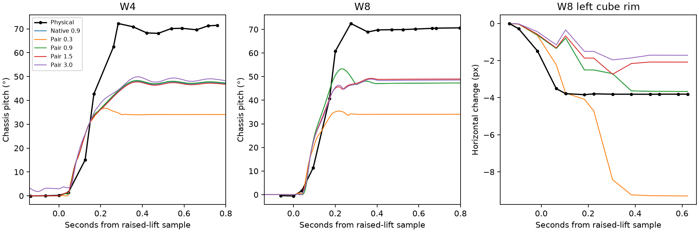

# Cube corner grip helps explain the initial push, but cannot reproduce the climb alone

Holding the wheel and lift replay fixed, we changed only the sliding friction between the cube's eight rubber corners and the table. The early W8 release and camera calibration come from the [rim projection comparison](ascent-projection.md). The target is both a nearly stationary cube during ascent and a peak chassis pitch near 72° on W4 and W8.

| Corner friction | W8 full rim error (px RMS) | W8 ascent rim error (px RMS) | W8 peak pitch | W4 peak pitch |
|---|---:|---:|---:|---:|
| 0.3 | 5.48 | 3.60 | 35.4° | 36.7° |
| 0.9 | 1.68 | 2.28 | 53.3° | 48.4° |
| 1.5 | 2.43 | 1.79 | 49.3° | 47.7° |
| 3.0 | 2.76 | 1.64 | 48.9° | 49.9° |

Weakening grip to 0.3 makes the full W8 image track worse and drops both peak angles. Increasing grip from 0.9 reduces rim error during the four-frame ascent interval, but increases error over the full sequence and lowers W8 peak pitch. Raising this single coefficient cannot satisfy the camera and pitch observations together in the tested range. The 3.0 case is a sensitivity probe, not a measured material property.

The explicit contact pairs use the same contact dimension, rubber contact time constant and damping as the original. The explicit 0.9 control reproduces W8 native peak pitch and both image scores within 0.000001 in their respective units. On W4, declaring the pairs at the original coefficient shifts peak pitch by 0.22°, so small W4 differences should be interpreted relative to the explicit-pair control. Other cube contacts, including the fork, retain native mixing. Each case uses the earlier release only. Both camera scores subtract the first observation in their respective window and average over the two rim patches. W4 supplies a second physical pitch trace, without a camera score.

[Results including held angle and lift tracking](corner-grip.csv) · [Replay script](corner_grip.py)
