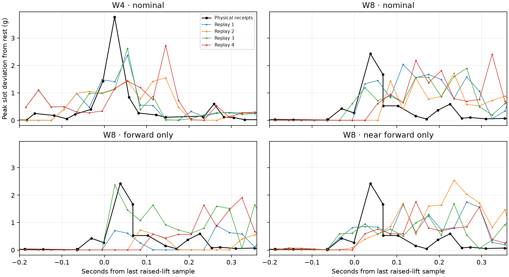

# Does the cube accelerometer resolve wheelstand starting depth?

In W8 the cube reported a 0.43 g departure from its resting acceleration vector at 3.531 s after the command. The first packet in the descent window to exceed 1 g arrived at 3.599 s, 68 ms later. The measured timing favors an earlier initial disturbance than either the nominal or farther replay produces. Matching the weak jolt alone leaves the strong response unresolved.

| W8 fore-aft cube position | Simulated first 0.2 g packet minus physical receipt | First 1 g packet minus physical receipt |
|---|---:|---:|
| Nominal, 49.77 mm | +25 to +115 ms | −13 to +107 ms |
| Farther, 52.97 mm | +55 to +145 ms | −13 and +197 ms, two cases below threshold throughout window |
| Closer, 46.64 mm, two cases starting clear | −5 and +55 ms | +77 ms in both |

At the closer depth, the other two cases start with 1.49 mm of overlap. They are retained in the CSV and plot. Nominal and farther cases all start clear. Lateral position is held at the nominal value. At the farther depth the fork loads first in every case. At nominal depth the chassis loads first, 5–102 ms after receipt of the physical 0.43 g packet. The signal could include vibration transmitted through the shelf. Its origin and the physical contact point are unknown.

W4 provides a check on interpreting the accelerometer as a fork sensor. Its first 0.2 g response in the same descent-relative window arrived at 3.851 s. The first simulated robot contact exceeding 10 mN in all four W4 cases came from a front tread support. The simulated first 0.2 g packet was 21 ms early or 69 ms late depending on release. Both a tread impact and fork contact can move the cube.

## Measurement

Each point is the largest three-axis deviation from the resting vector in the three slots of one cube packet. For physical data the reference is the median per-axis reading during the 0.8 s preceding the wheelstand command. The largest deviations in that reference window were 0.009 g for W4 and 0.007 g for W8. Simulated readings are decoded from the stock-format chip packets and referenced to the calibrated upright static vector. First crossings are restricted to −0.20 to +0.36 s around the last raised-lift sample. W8 also shows earlier disturbances during the approach, including a 2.28 g deviation near 1.53 s; the descent crossing is distinct from the first motion of the entire experiment.

The clocks here are physical host packet receipt versus simulated packet emission. BLE and host delay remain unmeasured. All three retained slots share the receipt timestamp. The 5 ms near-case match is smaller than one nominal 30 ms packet period. Timing cases reuse each physical recording. The data do not justify adopting a new depth or tuning the chip. [Per-case crossings and contact identities](cube-onset.csv) · [Pitch and contact-order comparison](pitch-order.md)

Reproduce with `python cube_onset.py fixture.xml` in the [wheelstand replay environment](contact-events.md).
