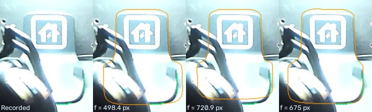
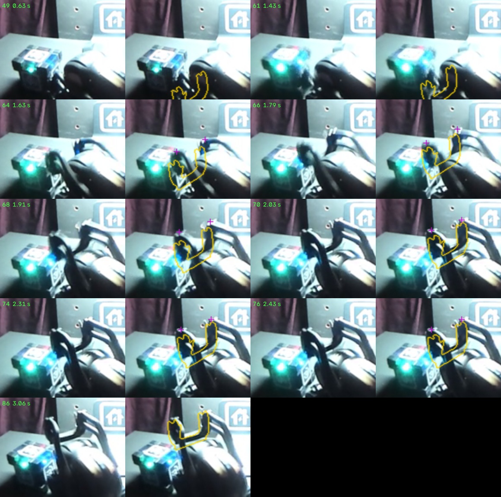

# W8 dock-outline camera calibration

The stock firmware specifies a 46 × 46 mm home marker centered 48.5 mm above the shelf. Webots specifies the same dimensions and prints the texture across the marker box. The horizontal firmware distance from marker to ramp lip is 94 mm; the canonical charger mesh places the marker plane 93.205 mm from its lip. The W8 camera reconstruction used the correct firmware marker size. [Firmware dimensions](https://github.com/os-vector/wire-os-victor/blob/3cec4844d24c4719b5b3892e4979494bcd260424/engine/charger.h#L114-L119) · [Webots charger](https://github.com/os-vector/wire-os-victor/blob/3cec4844d24c4719b5b3892e4979494bcd260424/simulator/protos/VictorCharger.proto) · [Webots marker](https://github.com/os-vector/wire-os-victor/blob/3cec4844d24c4719b5b3892e4979494bcd260424/simulator/protos/VisionMarker.proto)

Refitting the straight outer white edges, avoiding the rounded corners and the partial fork occlusion, moved the inferred corner coordinates by up to 1.8 native pixels. At each focal length we used the four resulting line intersections to fit the camera pose. We selected the focal length on the exposed front lip of the full charger mesh. The right edge of the ramp and the earlier fork-tip observations were reserved for evaluation.

| Camera fit | Lip RMS, native px | Right edge RMS, native px | Fork-tip RMS, movie px |
|---|---:|---:|---:|
| Original glyph picks, 498.4 px focal | 1.28 | 10.75 | 26.95 |
| Original glyph picks and cube rim, 720.9 px focal | 9.37 | 4.77 | 15.56 |
| Refitted glyph and dock lip, 675 px focal | 0.00 | 0.67 | 9.10 |

Native coordinates are 1920 × 1080; the movie is half that resolution. The lip score of zero is a raster tie on 14 columns of a nearly straight edge. It is not evidence of exact 3D calibration. Eleven rows on the right side were held out. Multiple sampled focal lengths from 670 through 695 px score below one native pixel on both dock edges. Those samples use the same physical frame. They are sensitivity checks, not independent repeats or a confidence interval.

The six early lift frames were excluded from focal and extrinsic calibration. The linked fork projection retains the previous backpack and SDK pose assumptions and late-frame fork heading reference. The earlier cube or fork residuals were not used to select the 675 px value. At maximum lift (frames 70, 74, 76), horizontal tip errors are within 1.1 movie pixels, but the near tip projects about 9.3 pixels below the hand pick and the far tip about 3.4 pixels below. Camera distortion, robot pose, landmark heights and fork geometry remain possible contributors. Use this result as a W8-specific registration. Transfer to another camera, recording or hardware configuration requires a separate check.

Reproduce with `python dock_outline.py Vic_charger_hp_geo.obj ../W8/precontact-crop.jpg fixture.xml ../W8/wheelstand.mp4` in the [fork projection environment](fork-projection.md). The [canonical charger fetcher](../../../web/tools/fetch_dock_model.py) pins the input OBJ by SHA-256. The script fits the border lines from image gradients, sweeps focal length, rasterizes the projected dock triangles and compares visible outer edges. [Full focal sweep](dock-outline.csv) · [Held-out tip residuals](fork-projection-dock-edges.csv)
