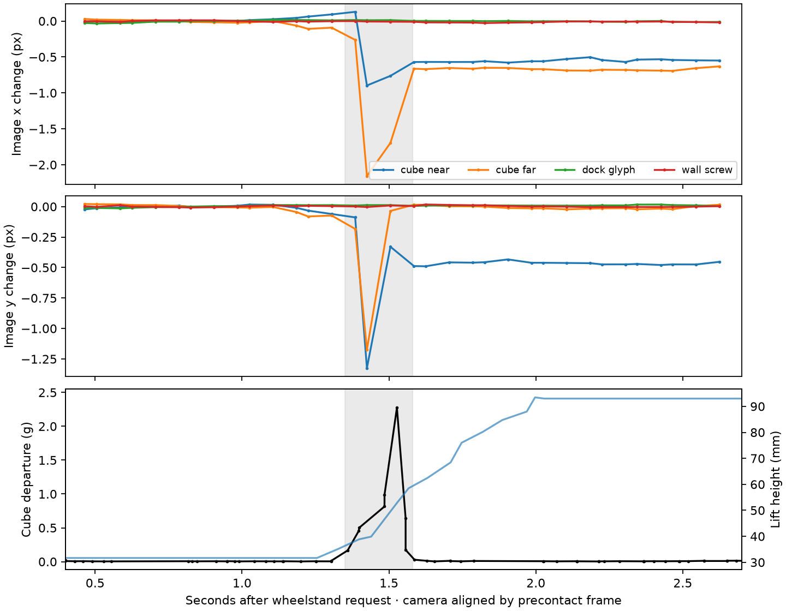
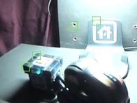

# The cube shifts during the first lift rise in W8

Two cube corners moved in the camera image during the early lift rise. The dock and a wall screw stayed steady. In the 1.35–1.58 s interval the four SDK wheel-speed samples were zero on both sides, the lift rose from 38.8 to 58.5 mm across those samples, and the cube accelerometer registered a peak departure of 2.28 g from rest. These observations give the approach replay a target before wheelstand descent.

| Feature | Largest displacement during rise, red / green | Largest before rise, red / green |
|---|---:|---:|
| Far cube corner | 2.46 / 2.47 px | 0.09 / 0.09 px |
| Near cube corner | 1.61 / 2.60 px | 0.04 / 0.15 px |

Distances in the table are measured after subtracting the mean displacement of the two fixed references in that channel. The reference tracks agreed within 0.08 px throughout 0.4–2.7 s. The plot shows the individual red-channel tracks before subtraction. Pre-rise spans 0.5–1.2 s and the peak search spans 1.3–1.7 s. Both corners peak in the same frame (approximately +1.425 s). The far corner retained a median horizontal shift of −0.67 px in red and −0.65 px in green over 1.8–2.6 s. The near corner estimate is more sensitive to the pulsing cube light.

The video clock uses frame presentation timestamps and one visual anchor. We matched the published native precontact crop (received at command +3.065 s) against every decoded frame. Frame 86 at video 5.640 s had the lowest mean absolute grayscale error in the robot region (2.43 intensity levels, runner-up 4.25). This assumes the camera and receipt clocks run at the same rate across the interval. Video frame spacing and packet receipt jitter limit attribution to an individual accelerometer slot. The image shifts include rotation, translation, perspective and brightness effects. They do not establish contact location or millimetres of planar travel.

Reproduce with `python early_cube_track.py ../W8/wheelstand.mp4 ../W8/precontact-crop.jpg` from this directory, with OpenCV, NumPy, Matplotlib and the [replay environment](contact-events.md). The 13×13 px reference patches are matched independently in the red and green channels with normalized cross-correlation and a subpixel quadratic peak. Reference is the first frame at or after +0.45 s. Tracks are centered on their pre-rise median. [Per-frame tracks and correlation](early-cube-track.csv) · [Cube packet comparison](cube-onset.md)
