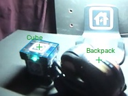
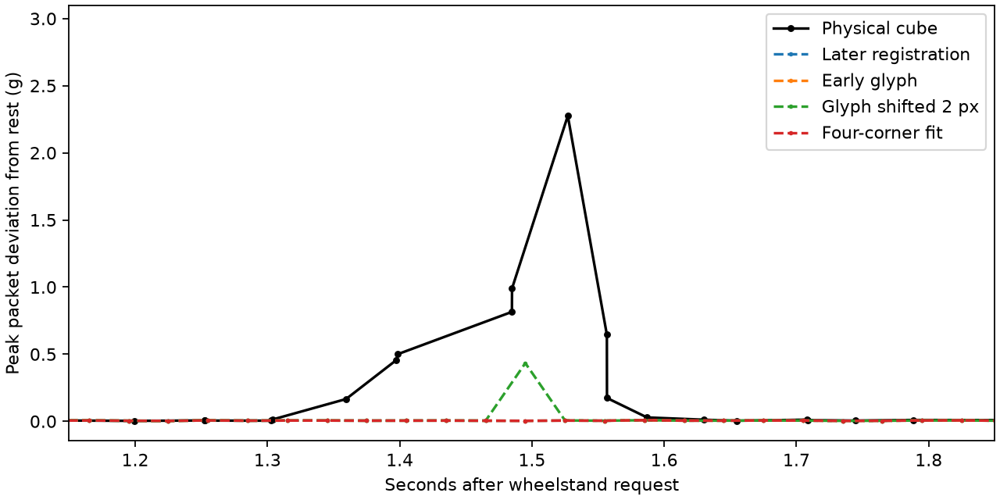

# Cube position before W8’s first lift rise

At command +0.625 s the cube center is estimated to be **62.6 mm forward and 29.8 mm right of the front axle**. Carrying the +3.065 s cube registration back through SDK odometry gives 74.4 mm forward and 19.8 mm right. These are two estimates of the same early pose; their difference does not measure how far the cube moved.

Frame 49 of the published video is timed from the [matched native reference frame](early-cube-track.md). The early observation uses the center of the top glyph at 44 mm and the forward end of the backpack indicator at 65.5 mm, with the existing dock-based fisheye calibration. Reflections soften the backpack pick. The lowered fork does not supply a clear transverse heading reference. We take the later raised-fork heading in the camera frame and transfer the measured SDK yaw change to the early instant. The position estimate is therefore only partly independent of odometry.

As a separate check on the cube landmark and orientation, we fit a horizontal 44 mm square to the four image corners. Its center is 62.5 mm forward and 31.5 mm right. Reprojection RMS is 2.40 movie pixels per coordinate. The fitted yaw, choosing the equivalent quarter-turn nearest the SDK observation, is 35.5° in the SDK world frame versus 50.7° from the SDK cube sighting. Rounded rubber corners, occlusion and the single view limit this heading estimate.

## Finite-actuator replay

All 15 replays start without penetration. They use the same recorded approach, driven tread supports, 60 mN m lift torque cap, 58-piece printed-fork fixture and simulated chip seed. The nominal early registration, the square-center estimate, the square heading and their combination all miss the early jolt. In one of the eight single-coordinate ±2 px sensitivity cases, moving the cube-center pick 2 px toward image right places the simulated fork against the cube at +1.470 s. The cube-top XY displacement peaks at 0.079 mm and the simulated packet departs 0.434 g from rest. The largest recorded departure in the same +1.30–1.65 s window was 2.28 g.

This is evidence of sensitivity to fork clearance within the uncertainty of the image picks. The single contacting case was selected after comparing outcomes. It cannot validate the cube pose or justify a grip change. Physical and simulated packet peaks use the maximum three-axis vector departure across the three retained slots, as in the [descent packet analysis](cube-onset.md). Physical times are host receipt times. Cube-top displacement is measured in the sim; the physical footage supports image-plane comparison.

Reproduce with `python early_pose.py fixture.xml ../W8/wheelstand.mp4` in the [fixture environment](contact-events.md) with OpenCV and SciPy installed. [All 15 pose and contact results](early-pose.csv)
