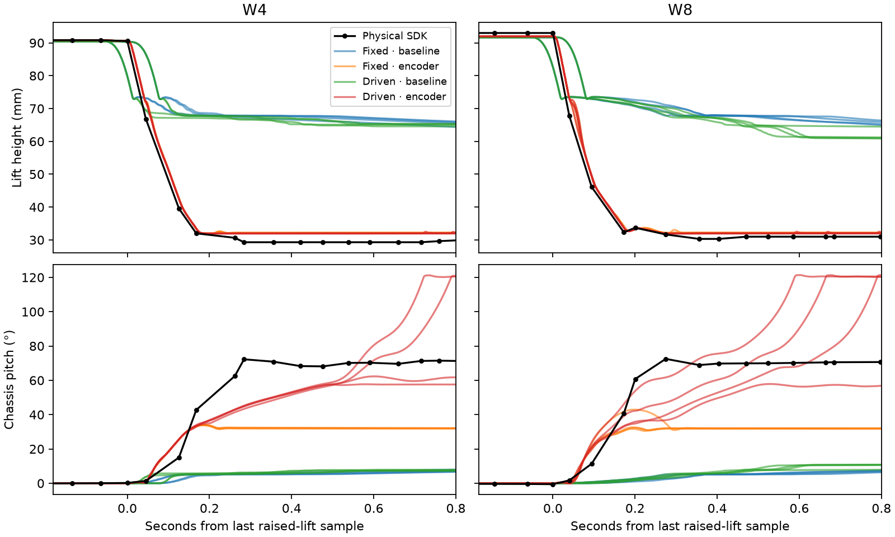

# Replaying the physical lift encoder through the wheelstand

The physical robot peaked near 72° and held near 70° in both recordings. We drove the simulated shoulder toward the measured lift height while leaving the chassis and cube free. Better lift tracking raised the chassis in both recordings. Whether it stopped short or went over depended strongly on how the rear tread support moved.

| Support and lift control | W4 peak pitch, four timings | W8 peak pitch, four timings |
|---|---:|---:|
| Fixed support, original 30 mN m servo | 6.6–8.0° | 6.4–7.5° |
| Driven support, original servo | 7.3–7.9° | 7.9–10.9° |
| Fixed support, follow encoder | 33.8–34.1° | 31.9–42.9° |
| Driven support, follow encoder | 57.7–121.2° | 57.9–121.4° |

Across the eight fixed-support encoder-following cases the median held angle per case was 31.8–32.3°. With driven supports five of eight encoder-following cases pitched past 120°. In one W4 case the simulated held angle was 71.6° after a 120.9° peak. The final angle alone would conceal that different trajectory.

This is a diagnostic intervention. The feedback target is linearly interpolated from each run's own SDK lift observations starting at the earlier possible descent onset. The virtual actuator uses 5 N m/rad stiffness, 0.03 N m s/rad damping and a 300 mN m cap. Simulated early torque reached 264–300 mN m across tracking cases. Physical motor torque was unmeasured. The stiff servo is present during settling as well, so altered preload is possible. Four physical samples in the first 200 ms constrain lift height to 2.9–3.4 mm RMS under this intervention; they do not determine the continuous path. Both recordings use the same settings. The robot drives and brakes according to the original replay logic, including its pitch-dependent drive cutoff. No latch or chassis pose constraint is applied.

The two interventions interact: driving the supports alone gains little at the original lift setting, whereas the same change with close lift tracking repeatedly sends the robot beyond its recorded peak. Contact and braking through the climb need to be validated together before these settings could predict a wheelstand.

[Per-case results](encoder-follow.csv) · [Replay script](encoder_follow.py)
