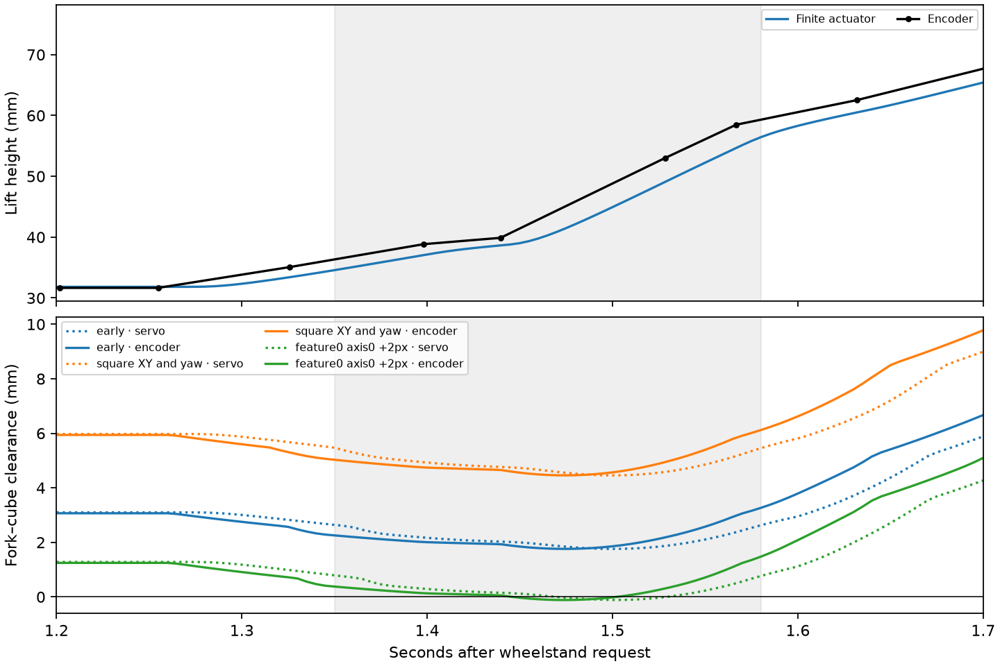

# Why substituting measured lift height does not recover W8’s early cube contact

The simulated lift crosses 35, 45 and 55 mm about 35, 30 and 25 ms later than the recorded encoder trajectory on a 5 ms grid. Substituting the measured height moves nearest approach earlier by 25 ms in all three tested starting poses. It changes the minimum fork–cube distance by under 0.003 mm in each. At the early glyph registration, the two closest surfaces remain separated horizontally.

| Cube registration | Minimum gap with finite actuator | Minimum gap with recorded lift | Recorded-lift time of minimum |
|---|---:|---:|---:|
| Early glyph | +1.760 mm | +1.760 mm | 1.475 s |
| Four-corner center and yaw | +4.457 mm | +4.457 mm | 1.475 s |
| Glyph shifted 2 px in image x | −0.113 mm | −0.115 mm | 1.475 s |

Positive values mean separation in the model. Negative values mean overlap with the cube held at its initial upright pose. All three nearest approaches involve the same modeled rubber corner. With the early glyph pose, the closest points on fork piece 8 and the corner differ by 1.52 mm forward, 0.88 mm left and less than 0.001 mm vertically in chassis coordinates. With the four-corner fit, the gap from piece 32 is 4.46 mm forward. These are model-space distances conditional on each registration. The video does not establish the physical clearance to this precision.

The [physical cube image and accelerometer](early-cube-track.md) both show motion during the shaded interval. At the shifted glyph pose, the recorded-height sweep first overlaps the cube at +1.450 s versus +1.470 s in the servo sweep. The [free-cube replay](early-pose.md) showed a small impact for this pose. This clearance check cannot infer a physical impact force or the identity of the real tooth. Resolving the horizontal fork-to-corner placement would discriminate the current contact hypotheses better than tuning lift latency.

## Method

Each of the three free replays supplies a chassis trajectory. At each sampled instant, all three joint variants use the same chassis state and the same fixed cube pose. The first variant retains the finite actuator’s shoulder and wrist angles. A control retains the shoulder and levels the wrist exactly. The third substitutes the interpolated SDK lift height, converts to shoulder angle through the canonical linkage and levels the wrist. Heights use the existing joint limits. A dynamic replay driven with encoder heights would additionally change forces and the subsequent chassis trajectory.

Every 5 ms from +1.20 to +1.70 s we query MuJoCo’s signed distances from the 58 printed-fork collision pieces to all 103 cube colliders. Bounding spheres discard pairs that cannot improve the running minimum. An exhaustive pair check at +1.475 s verifies the same minimum for each pose and joint variant. The physical encoder timestamps are host receipts; timing differences combine controller response and measurement timing. The missing tooth on the physical fork remains a hardware uncertainty.

Run `python fork_clearance.py fixture.xml` using [the original replay setup](contact-events.md) and the checked-in early pose CSV. [Per-sample distances, nearest surfaces and vectors](fork-clearance.csv)
