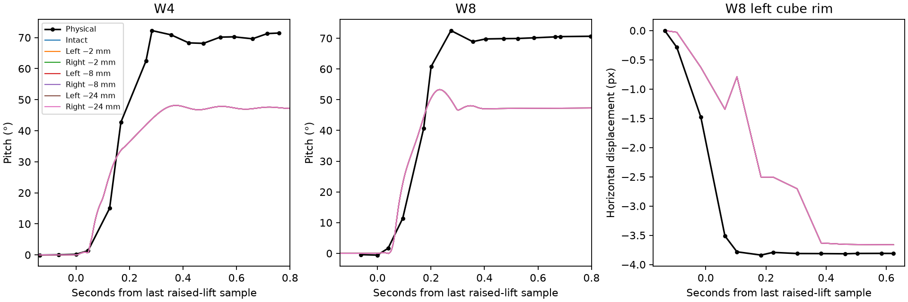

# The simulated wheelstand bears on the bottom crossbar

In both earlier-release replays, every positively loaded fork–cube contact sampled during the first 275 ms of ascent landed within **0.42 mm of the bottom of the printed fork**. The bottom is at −28.5 mm in wrist coordinates. W8 loaded only collision pieces 38 and 46, which form part of the lower crossbar. W4 also loaded pieces 14, 20 and 36 on the lower edge. These are simulated contact locations. The physical contact patch is obscured.

| Run | Loaded fork height, wrist coordinates | Normal impulse, right / left half | Simulated peak pitch |
|---|---:|---:|---:|
| W4 | −28.50 to −28.09 mm | 0.027 / 0.040 N s | 48.1° |
| W8 | −28.47 to −28.08 mm | 0.081 / 0.083 N s | 53.3° |

To approximate a missing tip we cut 2 or 8 mm from the free end of one printed upright at a time and tested both sides. An exaggerated 24 mm cut tested whether almost the entire upright mattered. All six variants reproduced the intact fork's pitch, lift error, sampled impulse and W8 rim scores to the reported precision. In these starting poses the missing rotation cannot be recovered by shortening an upright alone. The next geometric comparison is the lower bar's edge against the cube's top rim.

The intervention clips convex collision pieces wholly on the selected outer side (at least 14 mm from centre). It intersects the convex edges with a plane normal to the wrist z axis and removes completely clipped colliders. The cuts are sensitivity tests; the break plane and side on the physical printed part have not been measured. Crossbar mass and wrist inertia stay fixed. The [recorded lift and wheel replay](wheel-authority.md) leaves the cube and chassis free. Contact loads are sampled every 1 ms and summed by contact-point side. A brief unsampled contact is possible. The W8 camera scores use the dock calibration and the physical patches from the [ascent projection](ascent-projection.md).

[Contact piece names, impulses and camera scores](fork-damage.csv) · [Replay and mesh clipping](fork_damage.py)
