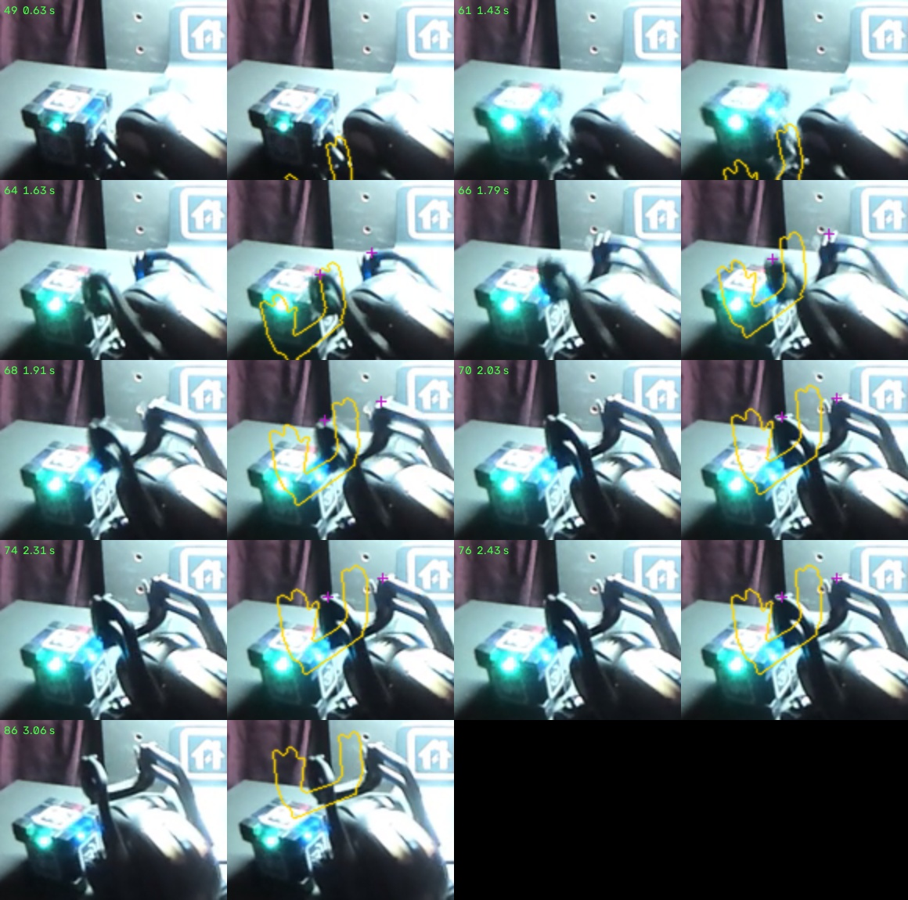
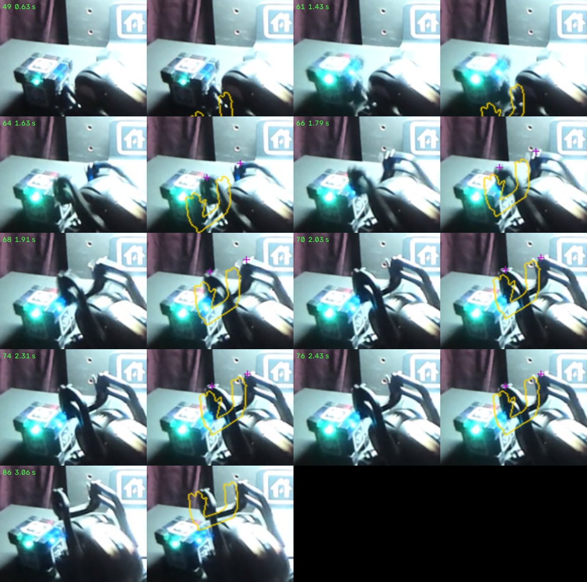

# Does the printed fork project onto the physical fork in W8?

The provisional dock-based calibration misses the two visible tips by **27.0 movie pixels RMS** over six frames of the early lift rise. Constraining focal length with the early cube rim reduces this to **15.6 pixels**. The fork tips in those six frames were held out from both fits. This discrepancy is large compared with the 2 px landmark adjustment that changed the [simulated contact outcome](early-pose.md).

| Measurement | Previous dock calibration | Dock and cube-rim fit |
|---|---:|---:|
| Focal length in native 1920×1080 coordinates | 498.4 px | 720.9 px |
| Early 44 mm cube rim RMS per coordinate at movie resolution | 2.40 px | 1.70 px |
| Early fork-tip radial RMS at movie resolution | 26.95 px | 15.56 px |
| Early cube center relative to front axle, forward / right | 62.6 / 29.8 mm | 79.1 / 38.4 mm |

Changing the camera fit moves the estimated center by 18.6 mm in the horizontal plane. The previously reported millimetre clearances remain valid **conditional on their registration**. The footage and present calibration do not locate the real fork relative to the cube to that accuracy. The all-corner focal estimate is also unstable: leaving out individual cube corners gives 580–892 px. Focal length here is an effective parameter of a provisional equidistant model, not a measured lens specification.

Each labeled pair shows the physical image, then the same image with the projected 58-piece collision fork in yellow. Magenta crosses are hand picks on visible upper edges. Frame 49 anchors the backpack position. Frame 86 supplies the heading reference using its transverse fork line. Intermediate headings and translations use relative SDK odometry; heights and pitch use the SDK traces. The mesh is leveled at the wrist and projected without an occlusion mask, so yellow outlines behind the cube may be visible. Frames 70, 74 and 76 repeat the high posture. The 12 tip observations are from one recording.

The comparison uses one lens model, fixed principal point, level upright cube, a 65.5 mm backpack landmark height and the measured center of the backpack indicator's forward end. Four dock-glyph corners determine camera pose at each focal length. A square fit to the four rounded cube corners at 44 mm elevation selects focal length for the second projection. For the score, each predicted tip is the average projected location of upper outboard mesh vertices within one vertical pixel of that side’s top edge. The physical tip picks were made on the unannotated held-out frames. Mesh shape, camera alignment, landmark selection, SDK heading and timing can all contribute to the residual. The comparison favors a camera and registration check with landmarks at several heights before changing fork geometry or friction.

Run `python fork_projection.py fixture.xml ../W8/wheelstand.mp4` with the [original fixture and environment](contact-events.md), OpenCV, SciPy and Matplotlib. [Original tip residuals](fork-projection-original.csv) · [Cube-rim tip residuals](fork-projection-rim.csv)
