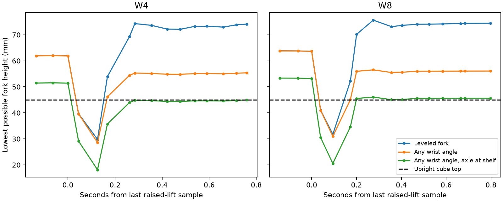

# Can the printed fork still support the robot at its recorded held pitch?

At the measured W4 and W8 held poses, the nominal wrist linkage places the lowest point on the printed fork **73.2 and 74.2 mm above the shelf** (median). An upright cube is 45 mm tall in this model. Even allowing any wrist angle about its hinge, the fork stays above 54.8 mm in every held sample on both recordings. Under these assumptions the fork can initiate the climb, but continuous fork contact with the upright cube cannot explain the 70° hold.

At +94 ms in W8 the leveled fork reaches down to 31.8 mm, low enough for the cube to intercept it if horizontally aligned. At +173 ms that minimum is already 52.2 mm. W4 shows the same transition, from 29.8 mm at +126 ms to 53.9 mm at +168 ms. These are sample brackets on vertical reach, not measured contact or release times.

The calculation uses the recorded pitch and lift in each SDK message and the 58-piece printed-fork fixture. In the chassis frame the wrist is one arm length from the lift pivot, at the angle inferred from encoder height. We retain reported heights outside the nominal command limits. Rotating the axle-to-wrist vector through recorded pitch gives wrist height above the rear axle. For the primary reconstruction the axle sits 10.45 mm above the shelf, the radius of the model's rear tip support. Horizontal translation cancels. The leveled wrist keeps the printed fork oriented with the chassis. For a free wrist rotating about its lateral hinge, subtracting the greatest vertex radius in the sagittal plane (28.54 mm) gives the lowest point attainable at any angle.

Dropping the axle centre all the way to shelf height is an extreme sensitivity test. Even then the median arbitrary-wrist minima are 44.6 and 45.6 mm. The main result depends on the axle support, the printed geometry, the body pitch estimate and the cube remaining upright. Roll is omitted. It does not identify which other body surface supports the physical robot, whether it balances on its rear, or the exact contact sequence. The existing [dynamic load map](fork-damage.md) measures where the simulated fork touches in its lower-pitch replay. A stronger test of the held state is to check the chassis and rear shell against the shelf and cube at the measured pitch.

[Per-sample reconstruction](fork-reach.csv) · [Reproduce from the printed fixture](fork_reach.py)
