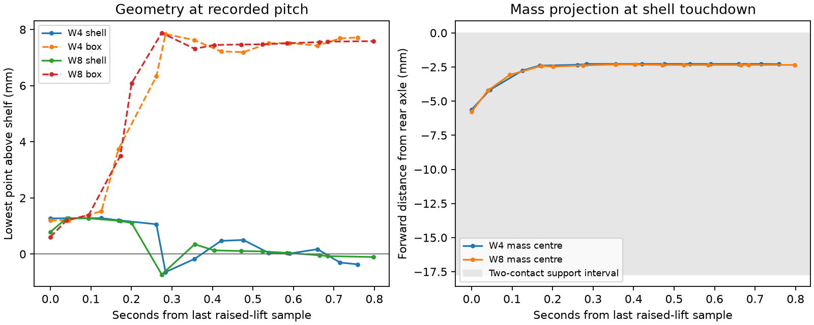

# Can the rear shell carry the recorded wheelstand hold?

Yes, under the nominal Vector 2 mass and geometry assumptions. The registered stock shell meets the shelf at 70.31° when rolling on the 10.75 mm rear tread radius. The earlier body-mesh calculation reported 70.35° on a 0.05° grid. The new check is whether the robot's weight can be supported there with its head and lift at their actual recorded positions.

| Quantity | W4 | W8 |
|---|---:|---:|
| Median measured held pitch | 70.14° | 70.15° |
| Rig shell clearance at held samples, median | 0.04 mm | 0.04 mm |
| Replay chassis box clearance, median | 7.51 mm | 7.51 mm |
| Horizontal mass centre behind rear axle at touchdown | 2.28 mm | 2.35 mm |
| Fraction of weight borne by shell in static equilibrium | 12.9% | 13.3% |

The shell touches 17.70 mm behind the rear axle. For a level shelf, the nominal mass centre falls between the shell and tread contacts in both held postures. The corresponding vertical forces are positive, with the tread carrying most of the weight. The printed fork can already have cleared the cube at this angle, as the [fork reach reconstruction](fork-reach.md) shows. This gives the physical hold a plausible cube-free support mechanism. The box used in the W4/W8 contact replay misses the rear support surface by about 7.5 mm at that same posture.

The Vector 2 mass centre is assumed. Combining the extremes of its existing horizontal and vertical parameter bounds moves the projected centre from about 15.7 mm behind the rear axle to 11.5 mm ahead. The forward extreme would tip forward without another support. These are sensitivity bounds. No physical contact force or centre of mass was measured. The 0.04 mm is agreement between two model inputs at the recorded median angles, not metrology of the shelf gap. The shell rig represents stock hardware, pitch is the SDK estimate, and the calculation omits roll, tread deformation and lateral imbalance.

Each SDK sample supplies pitch, head angle and lift height. The code registers the pinned stock mesh, solves for first shell touchdown, uses the canonical replay's articulated masses for each joint posture, and balances moments about the rear tread contact at touchdown. Held summaries use +0.4 to +0.8 s. Tread radius here is the modeled physical radius; the inset-wheel replay's surrogate rear tip cylinder is 0.3 mm smaller. Static feasibility says nothing about whether the simulated dynamics actually reach this pose.

[Per-sample clearances and mass sensitivity](held-support.csv) · [Reconstruction script](held_support.py)
