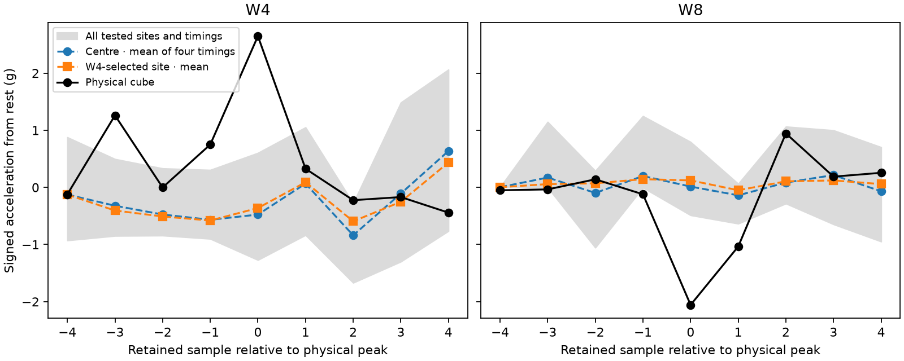

# Does moving the chip recover the wheelstand impact?

Across nine simulated accelerometer locations and four previously defined motion timings, the most negative W8 reading at the observed peak slot was −0.49 g. The physical cube recorded −2.06 g. On W4 the most positive prediction was +0.60 g against +2.65 g. These comparisons use the packet nearest the physical receipt and preserve the slot index within it. Receipt time includes transport uncertainty.

Each rigid cube carried nine simultaneous virtual probes with identical axes, filter, quantization, noise seed and clocks. The centre probe reproduced the original packet stream byte for byte in all eight replays. The other probes occupied the corners of the assumed ±15 mm chip-position box in parameters.json. Those coordinates are sensitivity tests. The physical board location is unknown.

Selecting the site by nine-slot mean absolute error across all four W4 timings gave (+15,+15,−15) mm. Freezing that location reduced W8 error from 0.572 to 0.547 g. Its closest prediction at W8's peak was −0.31 g, farther from the observation than the centre's −0.39 g. Flipping just the height of that probe changed mean error by less than 0.001 g on either recording. These two impacts give little basis for estimating chip height or adopting the selected offset. The grey band includes every tested timing and site at each slot. Its boundaries can come from different replays.

[Scores by site](impact-location.csv) · [Reproduce with the same fork fixture as replay.py](impact_location.py)
