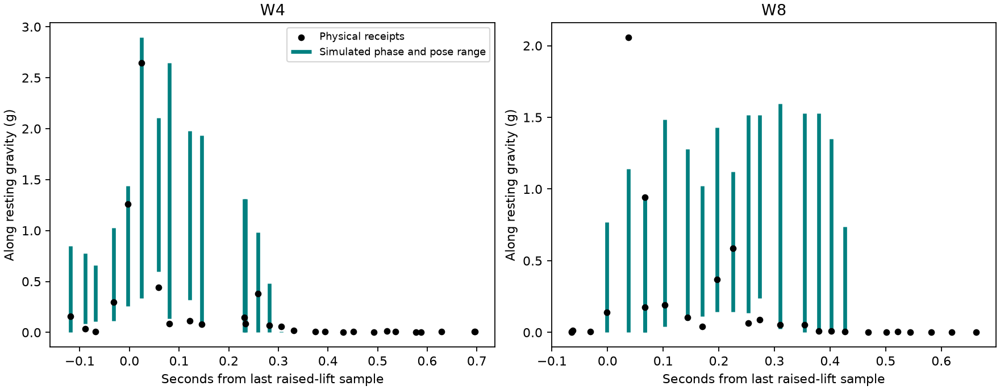

# Does the cube app miss the strongest simulated wheelstand impact?

On W8 the contact solver produced a peak of 2.34–3.50 g along the cube's resting gravity direction across the four existing timing cases. The physical cube reported 2.06 g. The strongest output of the simulated chip filter was already down to **1.59 g before frame selection**. At the particular receipt carrying the physical peak, even the most favorable tested sampling phase predicted only **1.14 g**.

| Peak along resting gravity | W4 | Held-out W8 |
|---|---:|---:|
| Observed physical packet | 2.65 g | 2.06 g |
| Largest substep in any timing case, before chip filter | 4.72 g | 3.50 g |
| Largest chip-filter output before frame sampling | 2.89 g | 1.59 g |
| Largest retained value at the physical peak's receipt | 2.89 g | 1.14 g |

W4 shows why phase matters: one timing case and some sampling phases allow the simulated measurement to span the physical peak. The same sweep leaves a shortfall on W8. A larger instantaneous contact force alone would be an incomplete calibration target. The duration and timing of the impulse, and the modeled sensor's frequency response, both affect the reported value. These two runs do not identify which input needs correction.

We retained each fixed-support, 30 mN·m MuJoCo trajectory from the [component comparison](acceleration-receipts.md) at 0.25 ms. At that same step we applied the canonical cube chip calibration, noise and filter. The original diagnostic advanced its sensor every fourth step. This pass checks the finer signal directly. Four phases of the 2 ms chip-frame clock crossed with ten phases of the 10 ms application clock give 40 combinations per timing case. For zero app phase, the reconstructed slots matched every word from the canonical packetizer. Amplitudes are departures from rest, along the resting acceleration vector in sensor coordinates. The plot matches packets to the nearest physical receipt without filling receiver gaps; each bar spans alternatives and is not a single trajectory or a confidence interval.

[All 320 outcomes](impact-phase.csv). Run `python impact_phase.py fixture.xml` in the [replay environment](contact-events.md).
