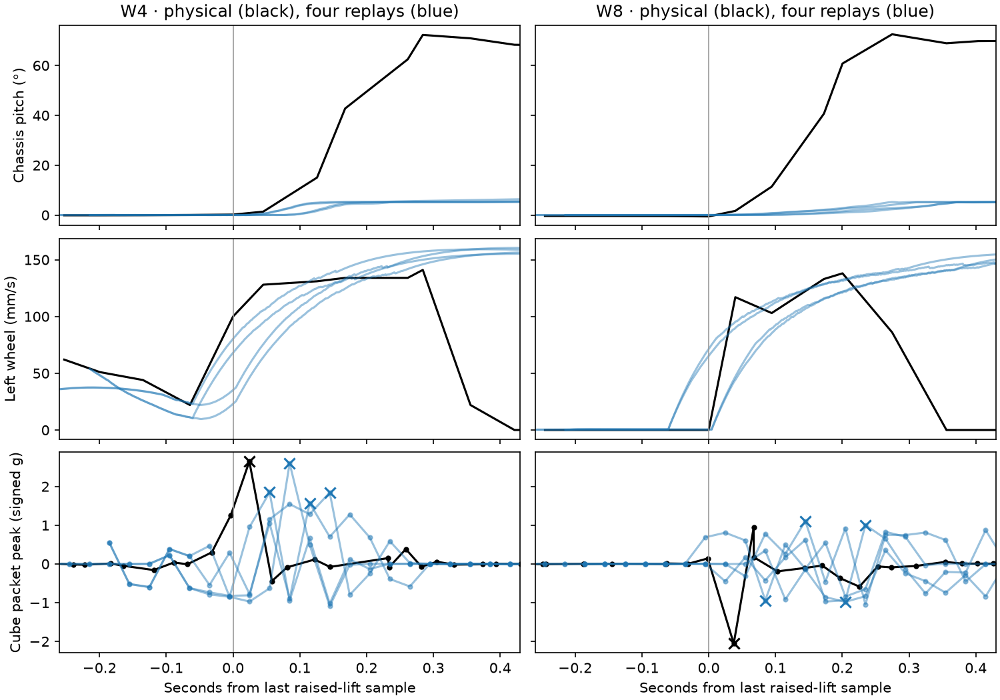

# The cube jolts while the chassis is still nearly level

In both physical wheelstands the largest cube jolt arrived before the first SDK pitch reading above 10°. At the peak packet receipt, linearly interpolated pitch was 0.8° in W4 and 1.5° in W8, and the left wheel was turning at 115 and 110 mm/s respectively. The cube excursions had opposite signs (+2.65 and −2.06 g along the resting up direction). Both chassis subsequently reached about 72°.

| Run | Peak packet after last raised-lift sample | SDK samples bracketing 20° on ascent | Time from peak receipt to estimated crossing |
|---|---:|---:|---:|
| W4 | 24 ms | 126–168 ms | 109 ms |
| W8 | 38 ms | 94–173 ms | 80 ms |

The fixed-support, 30 mN m replays peaked at 6.4–8.1° across the eight cases. None reached the first 10° landmark. W4 case 1 reached +2.60 g on the cube, yet reached only 6.8° on the chassis. A close cube amplitude on its own can therefore select a failed wheelstand. Subsequent contact changes should be judged jointly on the early packet and the chassis ascent.

The chart aligns both instruments on the last raised-lift observation used by the replay. Each cube point is the signed slot with greatest absolute departure in its three-slot packet, plotted at packet receipt. Crosses mark the largest departure in the scoring window. SDK and cube observations have independent sampling and transport delays. The table describes receipt ordering and gives the actual SDK brackets so that interpolation is distinguishable from timing precision. Simulated wheel speed is the front-left wheel's angular speed times its radius. The four blue lines vary release time and lift onset as in the preceding studies. This comparison diagnoses that configuration only.

[Per-case values and crossing brackets](impact-posture.csv) · [Replay and plotting script](impact_posture.py)
