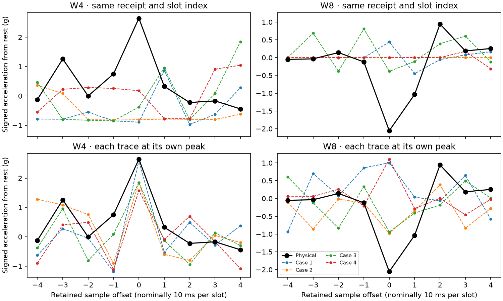

# Opposite impact signatures in two physical wheelstands

W8's largest departure along the resting acceleration vector was **negative**. Three successive retained samples read **−2.06, −1.04, +0.94 g** relative to rest. The first two were in the same BLE packet; the positive sample opened the following packet. W4's strongest departure was **positive**, with **+0.75, +2.65, +0.33 g** around the peak. These signed patterns give different contact targets even though both trials produced cube taps.

Under the fixed-support 30 mN·m model, the four W8 cases yield **−0.39 to +0.44 g** at the slot corresponding to the physical −2.06 g reading (nearest packet, same slot, nominal chip/app phase). Centering each replay on its own strongest absolute sample gives two positive and two negative peaks, all at or below 1.11 g in magnitude. Merely aligning extrema therefore fails to reproduce the recorded sequence. W4 case 1 reaches +2.60 g at its own peak, but its preceding slot is −1.19 g where the physical one is +0.75 g.

The full three-axis signal constrains a gravity-only explanation. After subtracting the configured chip bias and dividing each component by its configured scale, W8's vector magnitudes are **1.74 g** at the negative peak and **2.41 g** two slots later. Rest is 1.0004 g. Even allowing any instantaneous gravity direction, the distance from the latter vector to the unit gravity sphere is 1.41 g. This is a geometric bound on the calibrated reading; calibration and filtering limit its interpretation as instantaneous physical acceleration. Angular acceleration at the off-center chip, translation of the cube and contact vibration can all contribute.

Each panel uses nine consecutive retained slots. The longest physical inter-packet receipt interval in these windows was 34 ms on W4 and 39 ms on W8, so neither overlay bridges a previously identified >150 ms outage. Three slots share one receipt timestamp. Individual acquisition times and continuous pulse duration remain unresolved. The simulator configuration, onset cases and scoring window are the same as the [receipt comparison](acceleration-receipts.md). See also the [independent sampling phase sweep](impact-phase.md).

[Signed slot values](impact-slots.csv) · [Calibrated three-axis readings](impact-gravity.csv). Run `python impact_slots.py fixture.xml` in the existing replay environment.
