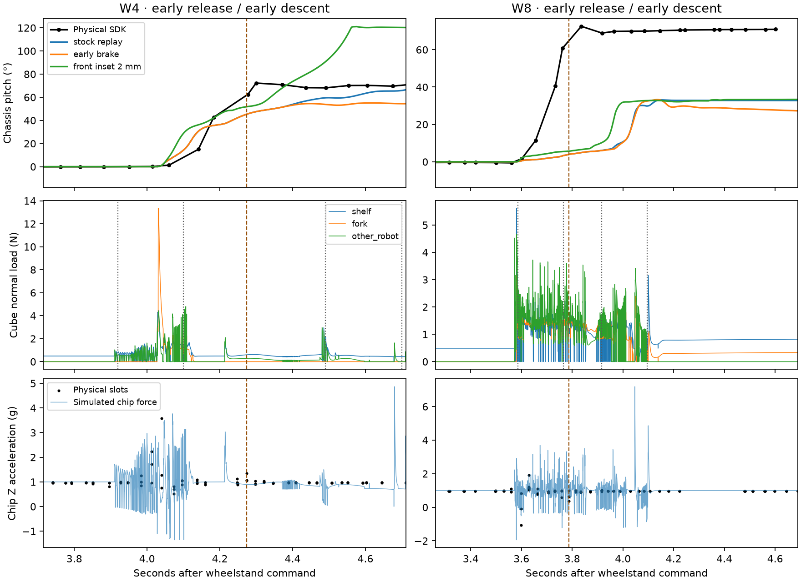

# Where the simulated wheelstand keeps triggering cube taps

On W8 the physical cube sent two counter changes. Starting 60 ms after the second change, the remaining 22 observed packets contained 66 retained accelerometer slots. Cube Z lay between 0.917 and 1.024 g, with a median of 0.970 g. Between-packet impulses could have been missed.

Across the four original release/descent cases, the driven-support, 60 mN m simulation produced seven packet changes more than 60 ms after the final physical change. The cube contacted the shelf in the preceding 30 ms for all seven. Six windows included the printed fork. Six included the chassis collision box, where peak summed non-fork robot normal load was 1.01–1.79 N. Five windows included both fork and chassis. These are simulated loads and establish contact co-occurrence. The real contact patch is unobserved.

The plot shows the early-release/early-descent case in each run. The brown dashed line is the final physical packet counter change. Dotted lines in the contact panel mark simulated changes. Simulated chip Z is the continuous specific force at the accelerometer site; physical points are the retained sensor slots plotted at packet receipt time. The other two pitch curves show the intervention tests below.

| Run | Change to replay | Late changes across four cases | Median held pitch |
|---|---|---:|---:|
| W4 | Original | 5 | 59.3° |
| W4 | Earlier braking | 2 | 51.1° |
| W4 | Chassis front inset 2 mm | 1 | 120.0° |
| W8 held-out | Original | 7 | 32.3° |
| W8 held-out | Earlier braking | 8 | 29.9° |
| W8 held-out | Chassis front inset 2 mm | 9 | 32.8° |

The physical held pitch was about 70° on both runs. The brake intervention capped the forward-drive interval using W4’s descending 70 mm/s crossing (mean of the two reported wheels), 327 ms after the last raised-lift sample. W8 used exactly that offset. The wheel-speed crossing is a proxy for brake timing; the recordings contain no corresponding motor command. The geometry intervention moved only the box’s front face backward and retained its rear face, width, height and the body’s explicit inertia. Two millimetres was a sensitivity probe. Neither intervention transferred, and the lower tap counts at W4 coexisted with poorer held posture.

Reproduce with `python late_contacts.py fixture.xml` using the [original fixture and environment](contact-events.md). The four initial-condition cases for each run use one physical trajectory. Counts across cases measure simulation sensitivity. The 30 ms preceding each changed packet spans three cube tick slots and is used to associate loads with candidate impacts; the exact detector edge may precede this window. Normal loads are summed separately by the other contacting body at each physics step, and the reported maxima may occur at different instants. [Per-case scores](late-contact-cases.csv) · [Per-packet loads](late-contact-loads.csv)
