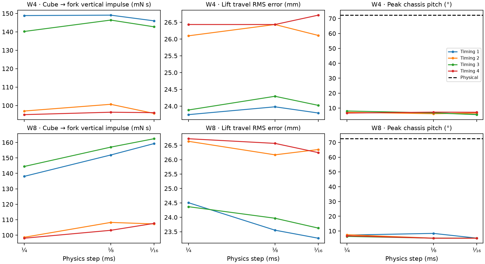

# The cube supports the fork, but the chassis hardly rises

In the first 200 ms after the last raised-lift observation, the simulated cube gave the printed fork **95–162 mN s of upward impulse** across W4 and W8. Dividing by the window duration gives an average upward force of 0.48–0.81 N. The net vertical impulse from cube contact on the rest of the robot was −21 to +8 mN s. These are simulated contact loads. Neither physical recording includes a force measurement.

Both physical wheelstands reached 72°. Across the four possible timings of each run, halving the integration step twice (0.25, 0.125 and 0.0625 ms) left all 24 replays below 8.5°. The early lift-height error was 23–27 mm RMS against four physical SDK samples per run. The failure persists under step refinement, even though the exact peak angle and impulse change. In W8 timing case 1, the fork impulse rose from 138 to 159 mN s with refinement while peak pitch fell from 7.3° to 5.2°.

This narrows the failure of the fixed-support, 30 mN m servo configuration: the fork already takes a substantial upward load from the cube. A successful model must also reproduce lift travel under that load and convert it into chassis rotation. Force distribution, lever arm and actuator response remain coupled here.

The code sums the full contact force on the robot, including friction, expressed in the world vertical direction. It integrates every physics step over the common 200 ms window and scores simulated lift height at the physical state receipts. Peak pitch is scored through +800 ms. Geometry, initial conditions, control tick and torque cap are fixed across step sizes; cube packet outputs are unused. Four timings per recording describe sensitivity to release and command onset. They are repeated simulations of one physical trial.

[Per-case measurements](load-transfer.csv) · [Reproduce with the printed-fork fixture](load_transfer.py)
