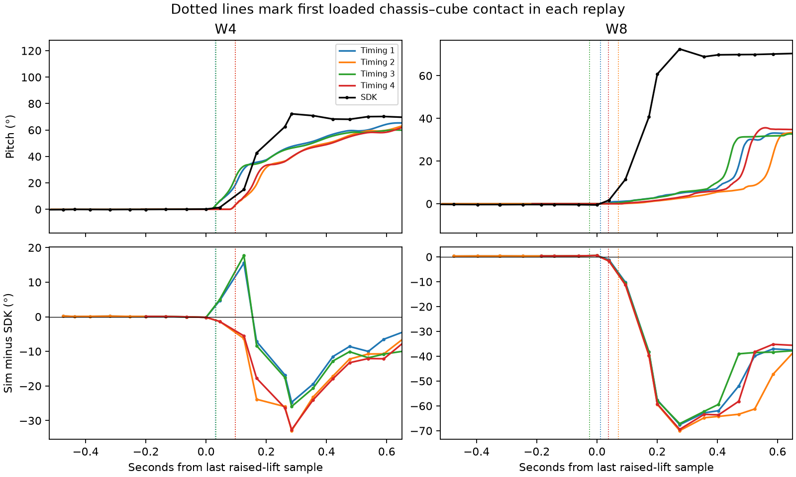

# When wheelstand pitch diverges

At W8’s nominal camera registration, all four replays agree with the available SDK pitch samples to within 1.67° before the first loaded chassis–cube contact. The first of two consecutive SDK samples with absolute pitch error above 10° occurs at 3.656 s after the request in each timing case, 23–120 ms after the first chassis contact. This establishes order at sample resolution. The maximum pre-contact error uses 3–10 SDK samples per case, so short excursions between samples remain unresolved.

In W4 the simulated fork loads 19–21 ms before the chassis. In W8 the chassis loads 6.5–43.8 ms before the fork. A load here is the first individual normal contact reaching 10 mN after replay release. These contacts come from the simulator. Neither physical recording directly resolves which part touched the cube first.

## How camera registration changes that result

We replayed the nominal W8 pose and the four existing camera solutions with the minimum and maximum forward and lateral positions. Each solution retains its paired coordinates. Two additional controls move just one axis from nominal to its value in the farthest-forward solution. All four release/descent assumptions use the same driven tread supports, finite lift torque and printed fork. Two late-release near-pose cases start with 1.27 mm overlap and should be treated separately. The cases in the table all have zero initial overlap.

| Initial cube position, forward / left (mm) | First loaded part across four cases | Range of held pitch |
|---|---|---:|
| Nominal, 49.77 / 0.45 | Chassis in all four | 29–35° |
| Far camera estimate, 52.97 / −2.72 | Fork in all four | 25–120° |
| Forward change alone, 52.97 / 0.45 | Fork in all four | 31–120° |
| Lateral change alone, 49.77 / −2.72 | Chassis in all four | 26–33° |

Forward depth alone reversed the contact order in this experiment. Under the forward-only change, the two early-release cases held 120° and 98° and the two late-release cases held 33° and 31°. The physical held pitch was about 70°. Selecting an intermediate depth to match that scalar would use the outcome to choose the input. A side view resolving the cube-to-fork clearance at first contact would independently constrain both the registration and contact sequence.

Run `python pitch_order.py fixture.xml` and `python contact_registration.py fixture.xml` in the [wheelstand replay environment](contact-events.md). SDK pitch residuals are evaluated at packet times by interpolating the simulated samples, accounting for their post-step timing. Camera variations are sensitivity cases from one recording. [Timing and residuals](pitch-order.csv) · [All camera cases](contact-registration.csv) · [Camera registration inputs](../W8/camera-pose.csv)
