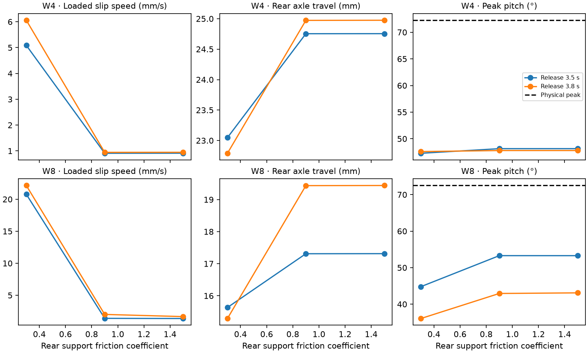

# Is the rear tread slipping enough to explain the missing ascent?

Increasing the rear tread support friction from 0.9 to 1.5 changed the simulated peak pitch by at most **0.17°** across four W4/W8 replay cases. At the original 0.9 setting the load-weighted forward slip speed was only **0.9–2.1 mm/s** during the first 275 ms of ascent. The physical chassis peaked near 72° on both runs. All four 1.5-friction replays remained below 54°.

Reducing friction to 0.3 provides a check that the intervention can produce slip. W8 then slid at 21–22 mm/s under load. Its rear axle advanced 1.7–4.1 mm less than at 0.9 and the peak fell by 6.9–8.5°. W4 was less sensitive. Raising friction above 0.9 changed axle travel by less than 0.004 mm in each paired case.

This result narrows the search to mechanisms beyond increasing rear grip in this configuration. The recordings supply wheel encoders and pitch; physical tread slip and rear-axle travel were not measured here.

## Method

The recorded wheel and lift trajectories drive the same bounded virtual servos as the [wheel tracking experiment](wheel-authority.md). Only sliding friction on the two driven rear tip cylinders changes. At each 1 ms sample the script checks the active contact coefficient and the other contacting body. All positively loaded contacts on these cylinders in the observed window were with the table. Cube and fork contact parameters are held fixed.

Slip is the absolute support-point velocity along the initial forward direction relative to the stationary table, weighted by normal force over time and both cylinders. It excludes lateral slip. Travel is the rear axle midpoint's net displacement along that same direction from the last raised-lift observation to +275 ms. This interval is common to both runs and ends near the physical pitch peaks. Peak chassis pitch is scored through +800 ms. The two release times per recording describe initial-condition sensitivity.

[All measurements](rear-grip.csv) · [Replay script](rear_grip.py)
