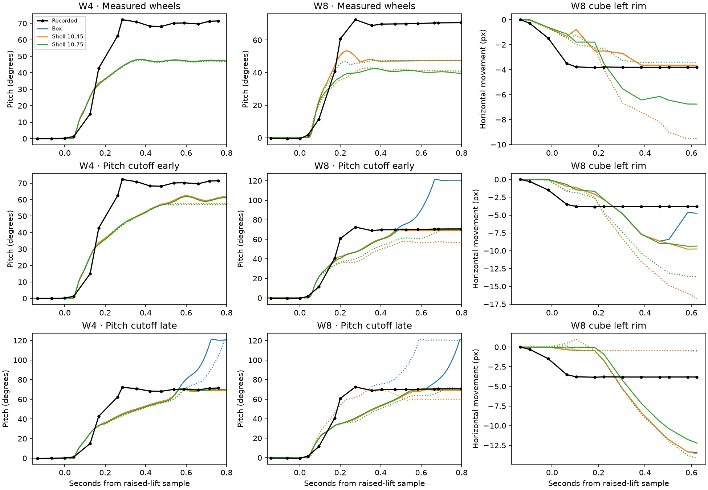

# Does the rear shell catch a wheelstand from a moving approach?

With recorded wheel speeds, the shelf never loads the rear shell in either recording. Across 12 replays, peak pitch is 42.5–53.3°. The physical peaks are 72.3° and 72.5°. A rear contact surface can explain how the robot stays up once it gets there. The climb with measured drive remains unresolved.

Black points are physical samples. Solid and dotted curves start at 3.5 and 3.8 s on the W4 clock, respectively, aligned separately to each recording. Colors identify the box-only chassis and the registered rear shell with 10.45 or 10.75 mm driven rear support radius. The two bottom rows use a nominal 150 mm/s wheel command with a pitch/time cutoff, at the two tested onset times. All runs track the recorded lift. The camera panel shows one rim horizontally. CSV image errors use both rim patches and both image axes after stationary-background correction.

With the 10.75 mm radius and late cutoff onset, the earlier release reaches 71.3° and holds a median 69.0° in W4, then reaches 70.7° and holds 70.3° in W8. Both actual holds are 70.1°. For the same inputs the box exceeds 121° on both runs. With the later release W8 still peaks at 71.7° but the hold median drops to 63.8°. A transient crossing alone is a poor success criterion.

Matching pitch comes at a cost. W8 full-window cube travel error in the first of those paired conditions is 5.95 px RMS, compared with 1.68 px for the earlier box replay using measured wheels. Even the best full-window cube fit in this grid (1.64 px) holds only 47.4°. The contact geometry improves a specific high-pitch failure, but these tests do not justify deploying it as a complete motion-model fix. Both recordings are from one robot. No physical force was measured.

[All 36 runs](shell-climb.csv) · [Reproducer](shell_climb.py) · [Static-release experiment and geometry](shell-settle.md). Supply the same printed-fork fixture and registered rig OBJ as the static-release experiment. First shell load is the first sampled shelf contact above 1 mN relative to the raised-lift sample. Blank means no such sample.
