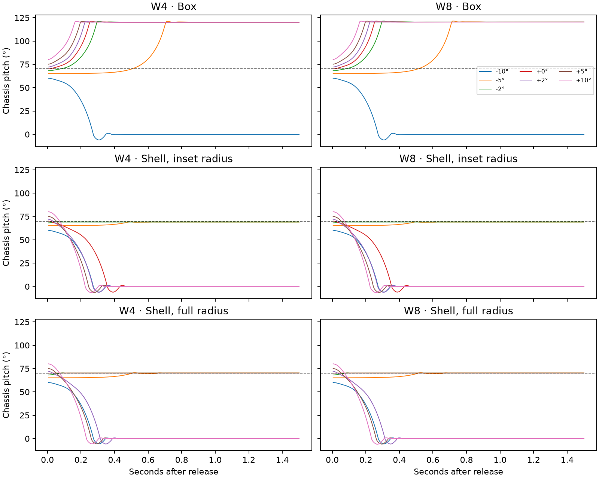

# The rear contour can dynamically hold the recorded wheelstand

From rest at each measured held angle, the replay's chassis box rolls backward past 120°. Adding the stock rear contour and using the full 10.75 mm rear tread radius instead yields a stable **70.28°** in both recordings. W4 and W8 physically held 70.14° and 70.15°. The cube is clear of the robot throughout this release test.

| Geometry | Started 5° below physical hold | Started at physical hold | Started 2° above hold |
|---|---:|---:|---:|
| Box and 10.45 mm rear support | 120.1–120.3° | 120.1–120.4° | 120.1–120.4° |
| Rear contour and 10.45 mm support | 69.05° | Back onto both treads | Back onto both treads |
| Rear contour and 10.75 mm support | 70.28° | 70.28° | Back onto both treads |

The two full-radius runs released at the measured pose put about 15.2% of body weight on the shell during the last 250 ms. This is a simulated reaction. The tilted equilibrium also captured releases 2° and 5° below the recorded pose; a release 10° below it fell forward. The dependence on starting angle matters because an actual wheelstand enters the hold with angular momentum.

The [static reconstruction](held-support.md) supplied the hypothesis. The additional collider is the convex hull of fixed stock shell vertices behind the rear axle, registered from the pinned rig. A horizontal supporting plane touches a convex hull at the same extreme as the supplied vertices. The added collider is masked for the shelf; the original chassis box is retained. The full-radius variant changes the rear support collision radius and its gear ratio to preserve tread surface speed; axle locations are fixed.

Each case uses the median held head and lift observations for that recording, converted to the simulator's joint targets (including ordinary lift travel limits). The free chassis starts from rest 0.05 mm above the supporting surface with zero wheel command. The simulation runs for 1.5 seconds with 0.25 ms steps. Only the starting pose uses recorded pitch. These 42 cases are perturbations of two measured postures from one robot. They establish a plausible local equilibrium and its sensitivity. They do not test the ascent, the robot's actual reaction forces or flat-ground drive after changing the support radius. Neither geometry change was promoted to a simulator default.

[All release angles and final reactions](shell-settle.csv) · [Replay script](shell_settle.py)
