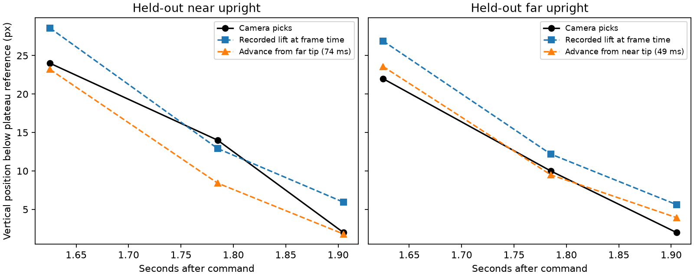

# Does the W8 fork follow the recorded lift during the rise?

Taking each upright’s fully raised position as its own reference removes the fixed camera offset seen on the plateau. Three earlier moving frames still have 5–6 movie pixels of radial travel error on average (RMS). Sampling the lift encoder later for each camera frame improves the opposite upright's predictions, with different estimates depending on which tip supplies the timing.

| Timing estimated on | Tip tested | Advance in encoder lookup | Travel error at frame time | Travel error after advance |
|---|---|---:|---:|---:|
| Near upright | Far upright | 49 ms | 5.71 px | 3.73 px |
| Far upright | Near upright | 74 ms | 5.23 px | 4.51 px |

The score uses both image axes. The plots show the vertical component. The reference for the timing test is frame 74. We hold the camera calibration, body pose, fork mesh and stationary reference fixed while varying only the time argument used for recorded lift height. Each side is fit on frames 64, 66 and 68 by minimizing radial RMS over a −80 to +80 ms grid. No candidate hits a grid boundary. A second test excludes one moving frame from the timing fit and scores the other side in that frame. Five of six errors decrease; in frame 66, the near side worsens from 2.05 to 5.72 px using the far side's 76 ms estimate. This is cross-testing within one event, and the video uses a single visual time anchor.

## Check on image tracking

Starting from frame 70, we tracked both tips forward through the plateau and backward through the rise with pyramidal Lucas–Kanade flow. By frame 69 (+1.985 s) both lie within 0.04 px of their frame-70 location; in frame 68 (+1.905 s) both are still more than 4 px away. SDK lift height crosses the model's 92 mm ceiling at +1.990 s by linear interpolation of the bracketing measurements. The video only brackets the final movement, so it cannot distinguish delays of a few tens of milliseconds here.

The near flow track at frame 64 differs by 12.0 px from the hand pick, despite a 0.15 px round-trip error on the last tracking step. The changing outline and neighboring cube make the low near tip difficult to follow. The independent hand picks are used for the timing scores above. The flow plot and raw series are retained to expose that limitation. [Flow and hand-pick comparison](tip-travel.png) · [Tracking coordinates and checks](tip-travel.csv)

These data support a timing contribution during the rise. A camera/encoder time shift cannot remove the different static offsets of the raised tips. Clock alignment, landmark visibility and moving hardware remain coupled in this single recording, so the fitted advances are diagnostic only.

Reproduce with `python tip_travel.py ../W8/wheelstand.mp4` and `python tip_phase.py fixture.xml ../W8/precontact-crop.jpg` in the [W8 projection environment](dock-outline.md). [Cross-tested timing scores](tip-phase.csv)
