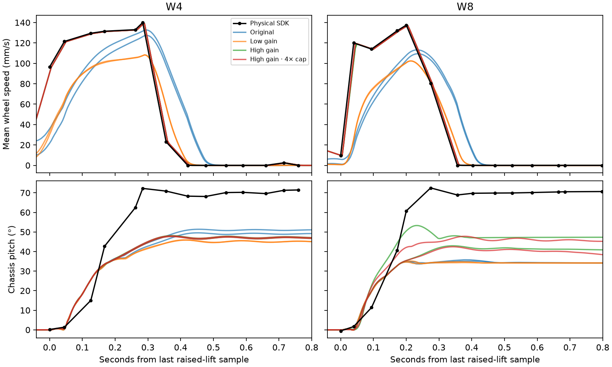

# Closely reproducing the wheel speeds still leaves the chassis low

A bounded virtual wheel-speed servo reduced combined left/right RMS error from 35–39 mm/s to **2.8 mm/s on W4 and 5.2–5.3 mm/s on W8**. Both wheelstands still fell short of the physical peak. This separates much of the tread-speed error from the remaining error in how the model converts rotation of the wheels into rotation of the chassis.

| Physical recording | Physical peak / held pitch | High-gain replay peak | High-gain replay held |
|---|---:|---:|---:|
| W4 | 72.3° / 70.1° | 47.8–48.1° | 46.9–47.3° |
| W8 | 72.5° / 70.2° | 42.9–53.3° | 41.3–47.2° |

Ranges cover two release times per recording. The table uses the model's reference stall torque as a symmetric per-wheel ceiling (156.25 mN m). Quadrupling that ceiling reduced W8's wheel error to 4.1 mm/s, with peak pitch still only 42.4–47.8°. Increasing available torque did not consistently increase pitch.

The diagnostic replaces the wheel motors with velocity actuators following interpolated SDK wheel speeds from release, updating targets every 5 ms. Velocity error is evaluated by MuJoCo at every physics step. The two tested velocity gains were 0.015 and 1.5 N m s/rad. The chassis and cube are free and the rear tread supports are driven. Every case uses the same recorded-height lift intervention as the [preceding experiment](encoder-follow.md); early lift RMS error for the high-gain cases remained 3.0–3.4 mm. The baseline uses the original speed controllers with the same recorded targets. The original and virtual actuators differ during settling as well. The diagnostic is conditioned on measured trajectories and is not a candidate motor calibration.

Wheel and pitch scores use SDK receipt times over the first 800 ms for wheel RMS and the replay trace over that interval for peak pitch. Held pitch is the median over 400–800 ms. Torque samples are at control ticks and can miss sub-tick peaks. The physical recordings give encoder speeds, not ground-relative tread slip, traction force, or fork contact location. Those remain possible sources of the missing rotation.

[Case results with wheel and lift errors](wheel-authority.csv) · [Replay script](wheel_authority.py)
