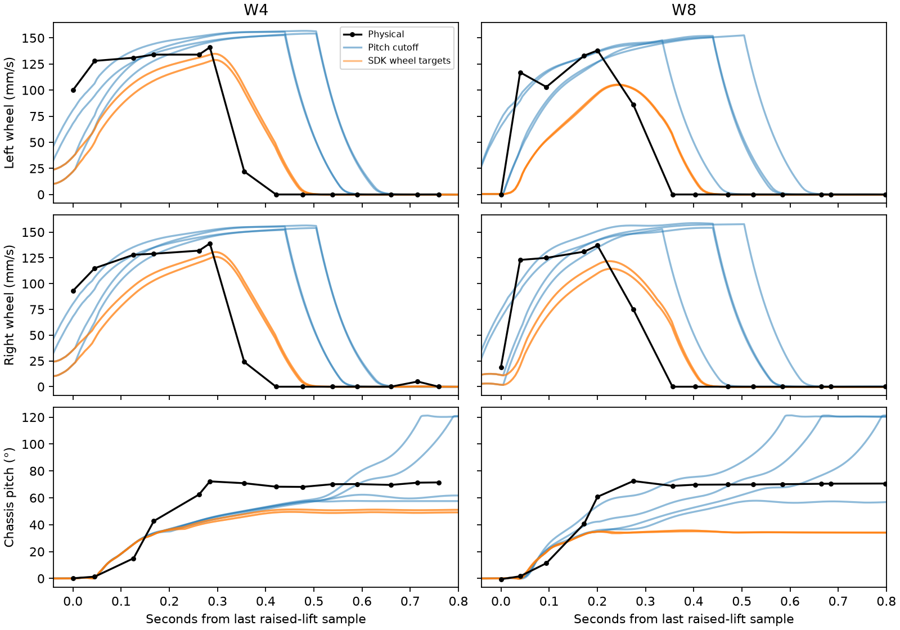

# Wheel speed during the wheelstand climb and stop

At the highest recorded pitch the physical treads were still moving in both runs. In W4 the SDK reported 141/139 mm/s left/right at 72.3°, then 22/24 mm/s 72 ms later. In W8 the wheels had already slowed to 86/75 mm/s at 72.5°, and both read zero 81 ms later. Both-zero readings first occurred at +421 ms (W4) and +356 ms (W8), relative to the last raised-lift sample. These are reported wheel speeds; the instant the motor command changed is unknown.

In the driven-support replay with lift encoder feedback, supplying interpolated physical wheel speeds as the tread controllers' targets eliminated the simulated flips beyond 120°. It also left the chassis well short of both physical peaks.

| Run | Peak with original pitch-dependent drive cutoff | Peak with recorded speed targets | Mean signed wheel error while physical mean speed ≥100 mm/s |
|---|---:|---:|---:|
| W4 | 58–121° | 50–51° | −24 to −32 mm/s |
| W8 | 58–121° | 35–36° | −52 to −58 mm/s |

Both wheels tracked better in overall RMS error in each paired case. When both physical wheels reported zero, simulated mean absolute wheel speed was 8–10 mm/s with recorded targets. Underprediction was more pronounced during powered ascent, especially on W8. Brake timing alone therefore cannot be isolated by sending the measured speed as a command: appreciable tracking error persists under load.

The physical lift trajectory is an input to every replay. The chassis and cube are free. The comparison changes only wheel targets from descent onset, retaining the motor and its original controller. Each wheel is scored independently at physical SDK receipts up to +800 ms. The two onset choices collapse to identical results for each release under recorded targets because both pre-onset and post-onset wheel commands then follow the same trace. The two release times still differ. The [previous lift experiment](encoder-follow.md) documents the strong diagnostic lift servo. No motor command, torque or position has been inferred from these wheel observations.

[Per-case results](wheel-follow.csv) · [Reproduction script](wheel_follow.py)
