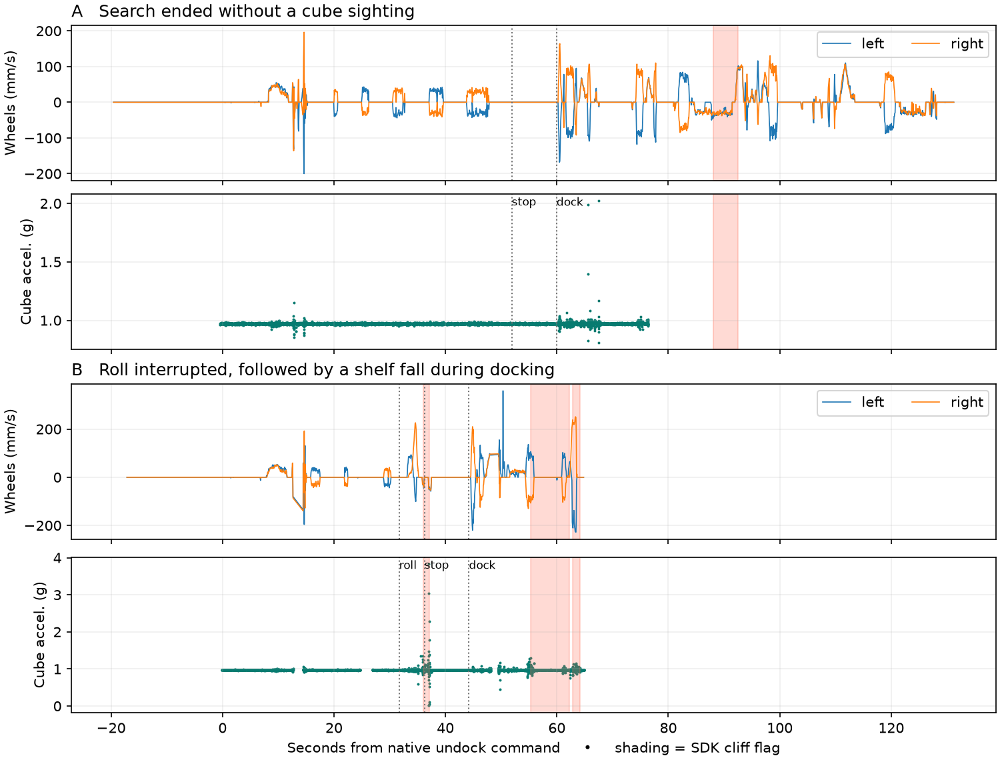
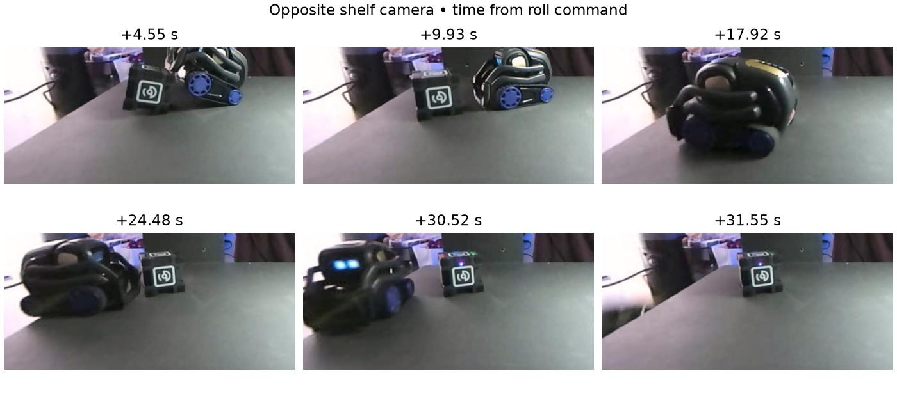

# Free cube roll and shelf fall

Two physical runs on the same shelf captured 2,514 and 1,367 robot-state receipts and 6,366 and 5,367 cube accelerometer samples respectively. Run A ended its search without a fresh visual cube pose. Run B saw the cube at 88.6 mm and began one stock roll. The cube rocked, then settled. Neither run establishes a successful flip.

In B the first SDK cliff flag arrived 4.30 s after the roll command. The action was cancelled and the post-stop capture began at 4.53 s. After eight seconds stationary, the flag had cleared and the cleanup routine started native docking at 12.53 s. The routine only checked the current cliff flag before starting docking. It retained no record of the earlier cliff event and did not monitor clearance or cancel docking on a new cliff event. A second cliff indication began at 23.61 s. The opposite shelf camera shows the robot at the edge at 30.52 s and out of view at 31.55 s. The operator confirmed a fall. Docking returned BEHAVIOR_COMPLETE_STATE even though the immediate battery reply lacked an on-platform indication. Subsequent external recovery was verified separately with both charging flags and the shelf camera.

Keep this shelf routine retired. A cliff event during manipulation must inhibit automatic recovery travel, even after the bit clears. Dock acquisition also needs independent clearance supervision. A bounded distance from the robot's starting position did not ensure containment on this shelf.

CSV times are host receipts in seconds from the start of native undocking. State pitch and head angle are radians, lift is millimetres, and wheel speeds are mm/s. Cube samples retain the three ordered slots per packet at their common receipt timestamp, with 8192 counts/g. A disconnected the cube before docking. B retained cube telemetry through docking. Camera times use V4L2 timestamps and the recorder's monotonic-to-wall-clock samples. Both machines reported network time synchronization. The displayed frames are subsampled, and cross-host latency was not measured in this session.
