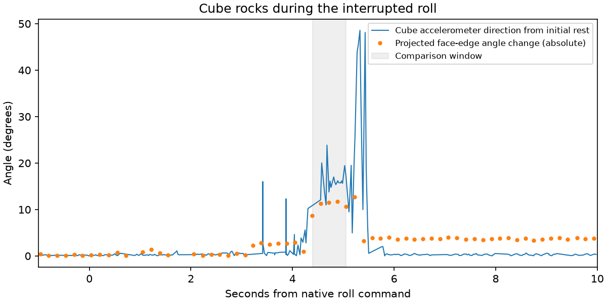
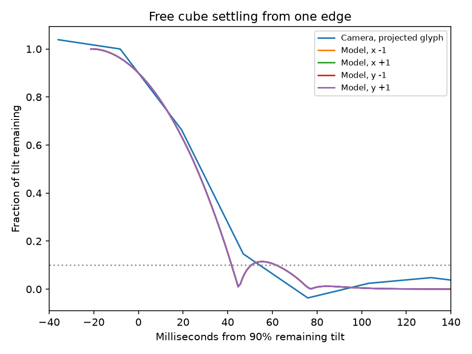
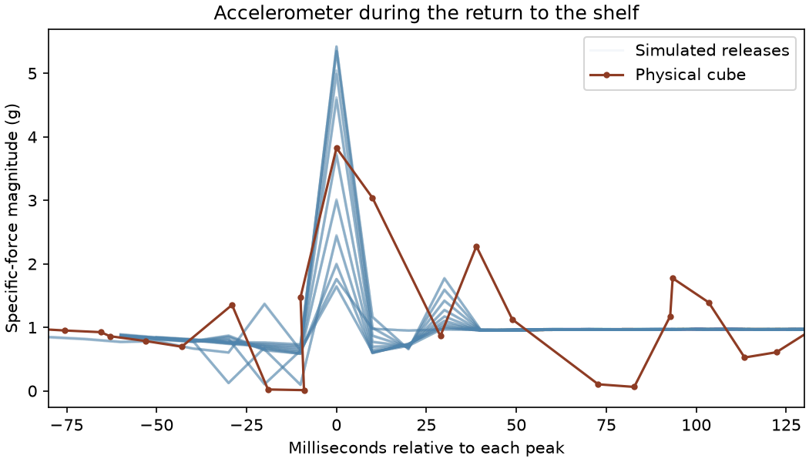
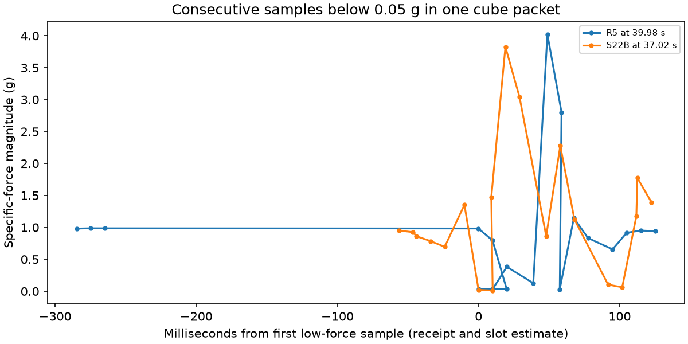
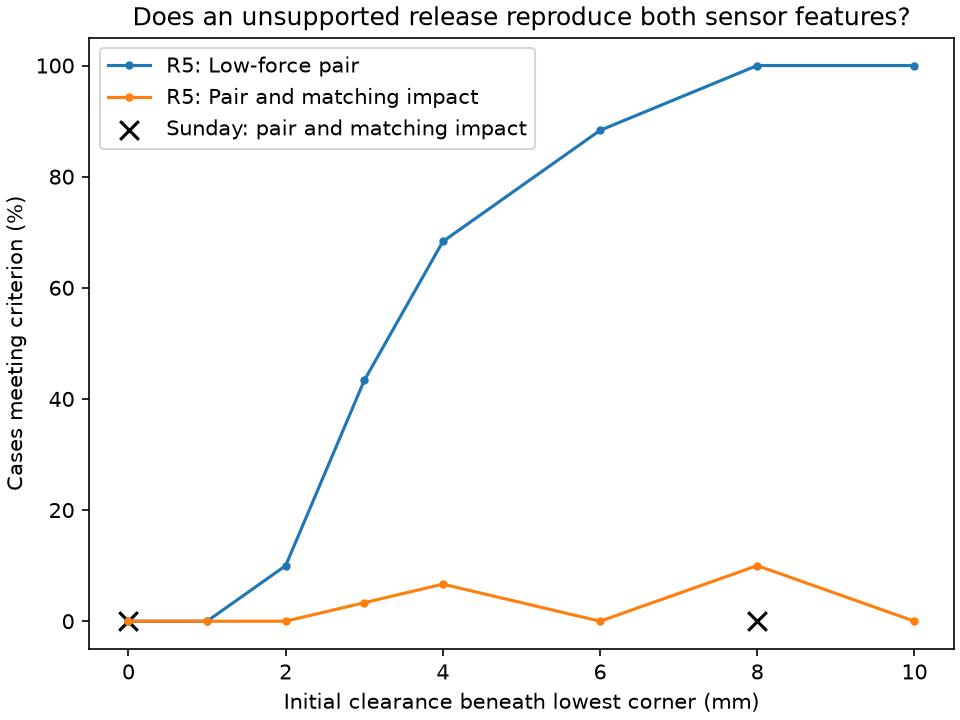
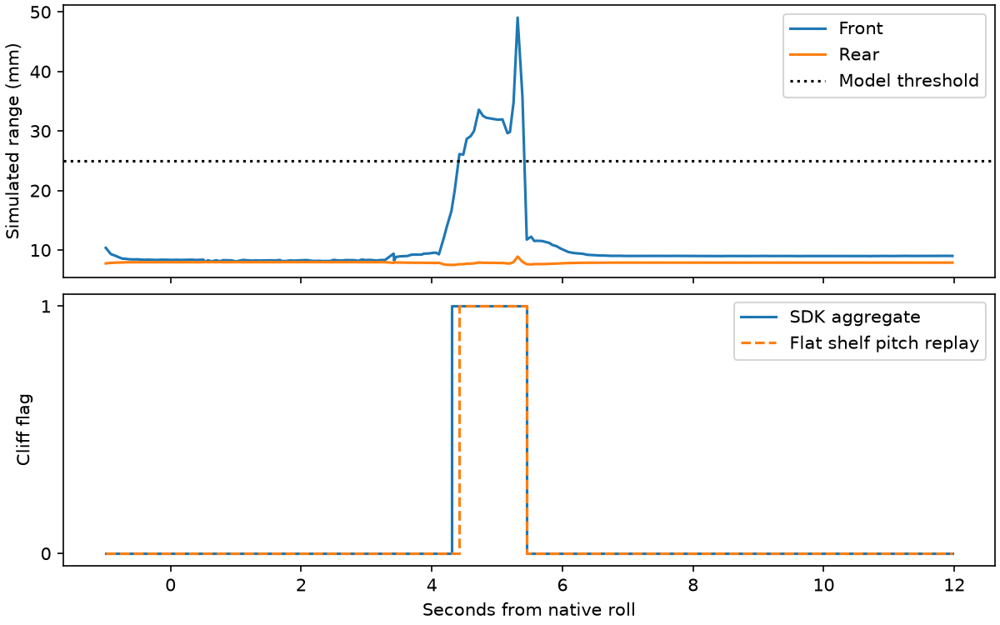

# Free cube roll and shelf fall

Two physical runs on the same shelf captured 2,514 and 1,367 robot-state receipts and 6,366 and 5,367 cube accelerometer samples respectively. Run A ended its search without a fresh visual cube pose. Run B saw the cube at 88.6 mm and began one stock roll. The cube rocked, then settled. Neither run establishes a successful flip.

In B the first SDK cliff flag arrived 4.30 s after the roll command. The action was cancelled and the post-stop capture began at 4.53 s. After eight seconds stationary, the flag had cleared and the cleanup routine started native docking at 12.53 s. The routine only checked the current cliff flag before starting docking. It retained no record of the earlier cliff event and did not monitor clearance or cancel docking on a new cliff event. A second cliff indication began at 23.61 s. The opposite shelf camera shows the robot at the edge at 30.52 s and out of view at 31.55 s. The operator confirmed a fall. Docking returned BEHAVIOR_COMPLETE_STATE even though the immediate battery reply lacked an on-platform indication. Subsequent external recovery was verified separately with both charging flags and the shelf camera.

Keep this shelf routine retired. A cliff event during manipulation must inhibit automatic recovery travel, even after the bit clears. Dock acquisition also needs independent clearance supervision. A bounded distance from the robot's starting position did not ensure containment on this shelf.

CSV times are host receipts in seconds from the start of native undocking. State pitch and head angle are radians, lift is millimetres, and wheel speeds are mm/s. Cube samples retain the three ordered slots per packet at their common receipt timestamp, with 8192 counts/g. A disconnected the cube before docking. B retained cube telemetry through docking. Camera times use V4L2 timestamps and the recorder's monotonic-to-wall-clock samples. Both machines reported network time synchronization. The displayed frames are subsampled, and cross-host latency was not measured in this session.

### Cube rocking before the docking incident

Between 4.40 and 5.05 s after roll initiation, the median change in the cube's accelerometer direction was 15.76° relative to the preceding second at rest. The median packet-averaged magnitude was 0.976 g (0.971 g before contact). The visible front glyph rotated clockwise by a median 11.56° in the corrected opposite-camera image over the same window. The estimate fits the central portion of the upper glyph border across multiple luminance thresholds. It yielded 78 of 81 usable frames. A short impact can rotate the acceleration vector independently of gravity, so use the sustained interval for a simulator comparison.

From 6 to 10 s the accelerometer returned to within 0.28° of its initial direction (median), while the projected edge sat 3.68° counterclockwise from its starting orientation. This residual is consistent with a changed viewing geometry. A single projected angle cannot isolate yaw, translation and tilt. Use the gravity-vector and camera observations separately when validating the cube model. Neither measurement by itself identifies corner friction.

### Unsupported settling time

The native opposite-camera frames resolve the fast return that the subsampled overlay missed. Linear interpolation gives **54.3 ms** from 90% to 10% of the projected edge rotation remaining, referenced to the local pre-drop and settled angles. Using just the frames that bracket each crossing gives **27.6–84.0 ms**. This is a sampling bound, not a statistical interval.

The production Vector 2 free-cube model released from rest at 15.76° takes **41.7 ms** for the corresponding fraction of true tilt on each of its four bottom edges. The calculation places the lowest collision geometry at the tabletop before release. No coefficients were fitted. The point estimate is 12.6 ms faster than the camera estimate, inside the frame brackets. The real fork's release velocity and residual support are unknown, and the camera angle is projected. This trial cannot distinguish a contact damping error from those effects.

### Cube accelerometer through landing

The recorded magnitude reached 3.825 g. Immediately before the packet containing that peak, two consecutive slots in a single packet read **0.022 and 0.012 g**. Their ordering within the packet is known. The horizontal axis estimates slot times from host receipt and nominal 10 ms ticks, so spacing across packet boundaries is less certain.

Releasing the unchanged model from 15.76° on each bottom edge and running its production Vector 2 accelerometer and default last-frame app yielded peaks of 1.63–5.43 g across 160 cases (four edges, ten app tick phases, four frame phases; fixed noise seed). The smallest sampled magnitude across those cases was **0.095 g**. The peak alone is a poor calibration target because it varies substantially with sampling phase. The much lower measured trough is a separate discrepancy. The unknown fork release and physical chip position limit attribution to any one model parameter. Near-zero specific force at the chip alone does not establish loss of external contact.

### Independent check for low force before impact

A scan of 83,508 decoded slots in 21 nonempty shelf recordings found two runs with adjacent slots below 0.05 g in the same packet. The independent R5 run produced 0.036 and 0.033 g during the commanded set-down of an improperly engaged cube, followed within 100 ms by 4.02 g. S22B produced 0.022 and 0.012 g before 3.83 g. Neither stationary recording had a sample below 0.05 g (1,656 slots combined). W8 had one isolated reading below threshold. Pair detection uses packet order and slot indices, independent of any host-clock alignment. The 100 ms peak window uses approximate receipt and slot timing.

This gives two separately recorded landing events against which to check a model of fork release. They have different starting geometries. A shared trough is evidence for repeatability of the sensor signature, but does not uniquely identify free flight, rubber compliance, or the fork trajectory.

### Release-clearance transfer

A gap beneath the lowest corner can generate the two very low samples. To test whether it also predicts the impact, release the cube from rest with its measured preceding tilt (R5 approximately 31.5°, Sunday 15.76°). Sweep 0, 1, 2, 3, 4, 6, 8 and 10 mm on R5. Each clearance has 240 combinations of edge, chip sampling phase and position in the three-slot packet. Score an adjacent same-packet pair below 0.05 g followed by a maximum within 5% of the recorded peak over the following samples through 100 ms from the first slot. All fractions describe this finite grid.

R5 selects 8 mm: all 240 cases produce the pair and 24 also match the 4.02 g peak. At zero clearance neither run produces the pair. With 8 mm frozen on Sunday, all 240 cases again produce the pair but **none matches the 3.83 g peak**. Clearance and release velocity were not measured. The grid used zero initial velocity and discrete sampling phases. This result provides no basis for adding a fixed clearance to the simulator or inferring that either cube actually dropped 8 mm.

### Could pitch alone produce the first cliff flag?

The SDK exposed the aggregate flag, without the four optical readings. Replaying each recorded chassis pitch over a continuous level table with zero roll, at the height where the lowest tread or axle support touches the surface, produced a cliff flag on 17 of the 19 flagged Sunday receipts and zero others in the 217-receipt roll window. At the first real flag the SDK reported 9.85° pitch. The model's front rays were then 16.54 mm, below their assumed 25 mm threshold. The model first flagged 123 ms later. The real guard cancelled the roll; subsequent native docking was a separate command.

A 16.5 mm threshold, selected on Sunday by minimizing receipt disagreements (ties favor the existing threshold), matched all 217 Sunday receipts. With the threshold frozen, disagreements dropped from one to zero in each of two earlier wheelstands (W4: 98 receipts, W8: 94). This improves four aggregate observations across these three maneuvers. Unknown chassis height, roll, optical reflectivity and SDK receipt timing limit inference of an actual sensor distance. The test does not reconstruct the later shelf departure. Keep the production threshold pending an independent distance or drop-height measurement.

