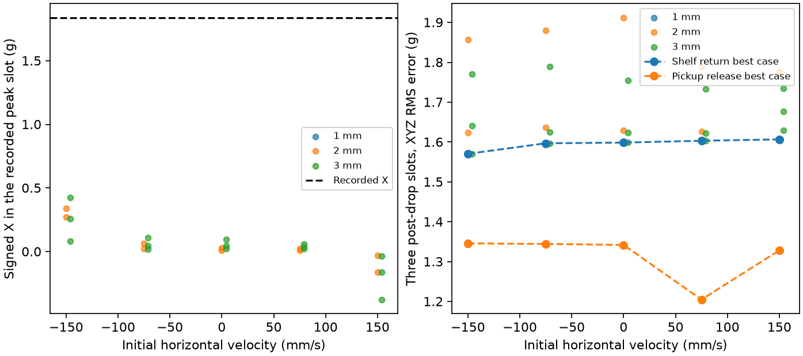

# Does horizontal motion at release explain the cube impact?

Two physical recordings have a pair of near-zero accelerometer samples in one Bluetooth notification, followed by a strong impact. We tested whether sliding into contact gives the web simulator the signed acceleration seen in the next three samples.

The browser replay uses the generation-two free-cube scene, its eight rubber corners, the MuJoCo WASM physics step, and the ordinary CubeSensor packet path. The shelf release starts at the measured late, flat-corrected tilt. The pickup release uses its post-reverse gravity direction. The cube starts 1, 2 or 3 mm above its lowest corner's support plane, with world-X velocity −150, −75, 0, +75 or +150 mm/s. Each case has six release phases 5 ms apart relative to the 30 ms packet period. The initial angular velocity is zero. These are sensitivity settings; the camera did not measure the listed initial velocities.

Each candidate must put both low-force samples below 0.05 g in the same slots as the physical pair. We then compare all nine signed components in the next three slots without a time shift. The comparison assumes consecutive received packets. Release cases use the stock-format software packet path. They do not use an attached cube firmware VM. Both contacts are free landings in the replay, so fork contact during impact or a different release pose remains possible.

| Comparison | Shelf return | Pickup release |
|---|---:|---:|
| Cases matching the low-force pair | 25/90 | 25/90 |
| Best three-slot RMS error at zero speed | 1.599 g | 1.342 g |
| Best at −150 mm/s, favored on the shelf return | 1.571 g | 1.346 g |
| Best at +75 mm/s | 1.603 g | 1.205 g |

For the shelf return, the largest simulated X reading in the recorded peak slot rose from +0.094 g at zero speed to +0.424 g at −150 mm/s. The physical reading was +1.838 g. The shelf-favored speed slightly worsened the best pickup-release residual. The per-speed minima allow gap and timing phase to vary within each run, so these scores are optimistic. They support neither assigning a shared release speed nor retuning rubber friction from these two impacts alone.

[Web replay](browser_impact_slip.mjs) · [Shelf return cases](browser-impact-slip.csv) · [Pickup release cases](browser-impact-slip-pickup.csv) · [Plot](plot_browser_impact_slip.py)
