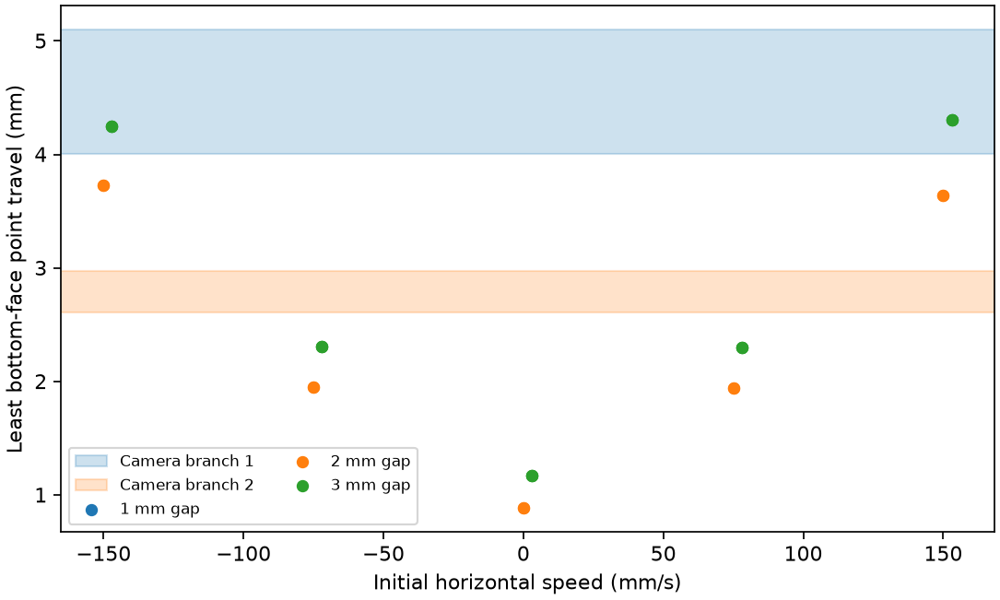
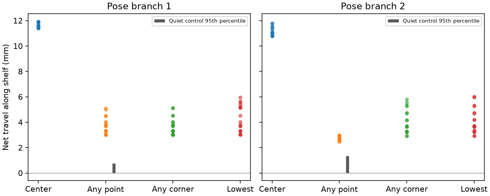

# Did the cube rotate around one planted edge?

The 11–12 mm center displacement includes rotation around the bottom of the cube. Tracking the same material points across the two reconstructed poses tests whether a planted edge can explain the entire event. At threshold 80, where stationary controls were most consistent, **even the least-moving point on the continuous bottom face traveled 4.01–5.10 mm horizontally** on the primary pose branch. The alternative pose gave 2.60–2.98 mm. Both are endpoint estimates across the held and settled windows. They allow motion during fork contact, in flight, on landing or through a change of supporting corners.

For a rigid body, displacement is affine in material coordinates. Projecting the four corner displacements onto the shelf gives a convex quadrilateral of all possible bottom-face displacements. The distance from its convex hull to the origin is the smallest displacement of any such point, including locations along edges. The 44.3 mm cube envelope includes the spaces between its rubber feet, making the search more permissive than restricting the pivot to actual corners.

We used the same corrected 23 mm glyph, 3 held and 5 settled frames, focal perturbations and shelf references as the [center comparison](release-translation.md). Here we fit a pose to the median corner coordinates in each window so that all four material points share the same rigid transform. Across all thresholds, primary-branch minimum travel was 3.01–5.10 mm, with the initially lowest envelope corner moving 3.01–5.97 mm. Individual frame pairs and the alternate planar pose are more sensitive.

**Stationary control.** Pairs of 3-frame and 5-frame windows from the before-roll and settled video were selected with median separation within 35 ms of 196 ms. Threshold 80's largest apparent minimum travel was 0.42 mm on the primary branch and 0.89 mm on the alternate. Thresholds 90 and 100 occasionally produced large apparent jumps even during the control periods (up to 29.4 mm). Threshold 80 was selected using that control, not the simulated slip. The windows overlap and reuse the same frames across focal and reference variants. They describe sensitivity rather than independent trials or confidence limits. For individual held/settled frame pairs at threshold 80 the alternative branch admits 0.55 mm, inside its stationary-control range.

**Canonical browser replay.** Applying the same lower-face test to the 25 of 90 releases with the recorded low-force pair gives 0.89–1.17 mm at zero initial horizontal speed, 1.94–2.31 mm at either sign of 75 mm/s, and 3.64–4.30 mm at either sign of 150 mm/s. Some fast cases overlap the primary camera estimate. Both signs give similar minimum travel, and those cases still fail the [signed peak-slot acceleration comparison](browser-impact-slip.md). These results constrain the motion across the event but cannot identify sliding friction or the release velocity.

[Camera scores](material-pivot.csv) · [Stationary controls](material-pivot-controls.csv) · [Web replay scores](browser-pivot.csv) · [Modeled corner displacements](browser-pivot-corners.csv). Run material_pivot.py, browser_impact_slip.mjs with `--pivot`, then compare_pivot.py to regenerate.
