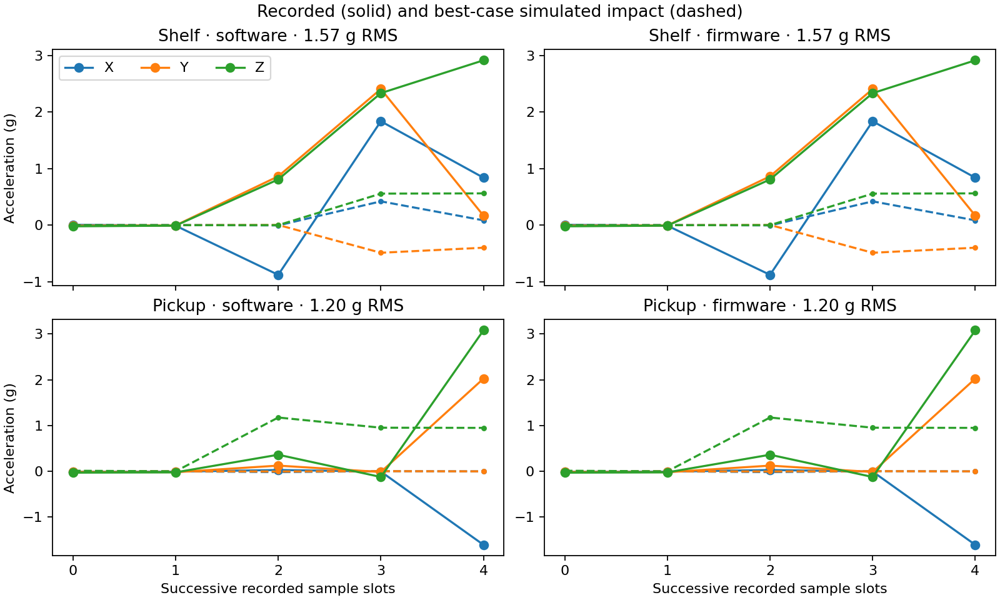

# Does the cube firmware change the simulated release impact?

The browser sensor and the attached stock cube firmware emitted identical accelerometer counts in all **3,600 sample slots**. The corresponding packet times and tap counters matched too. The experiment covers two recorded poses, 90 release conditions per pose and two sensor implementations. The two paths share the virtual accelerometer and its input filter. This result isolates the firmware packet handling for these releases.



The solid curves show five successive physical samples. The dashed curves show the lowest-error simulation for that recording after requiring two successive samples below 0.05 g in the observed packet slots. The RMS averages nine signed axis errors over the following three samples. Shelf and pickup have independently selected dashed curves, so these errors are optimistic.

| Physical release | Qualifying cases per path | Best RMS per path | Physical peak magnitude in the five slots |
|---|---:|---:|---:|
| Shelf return | 25/90 | 1.568 g | 3.83 g in sample 4 |
| Pickup | 26/90 | 1.205 g | 4.02 g in sample 5 |

**Transfer.** The shelf-selected 3 mm gap, −150 mm/s world-X release speed and 15 ms phase missed the low-force pair on pickup. Its first pickup slot still read 0.971 g, versus 0.036 g recorded. Sampling phase is unknown in the physical trials. Allowing only phase to vary recovered the pair at three of six phases, but the most favorable pickup impact still had 1.344 g RMS error. Packet phase can explain missing the low-force pair in this frozen test. Neither choice of firmware explains the remaining impact shape. Actual fork contact, release velocities and sensor response during impact are still open.

## Reproduce

The [original contact experiment](../browser-impact-slip.md) defines the poses, velocities, gap and phase grid. Both sensor paths here use a 1.05 s settle plus the phase offset, check for a live packet before release and capture the following 200 ms. The verified 2018-08-14 cube image is pinned by SHA-256 in [the firmware fetcher](../../../../web/tools/fetch_firmware.py). The ordinary script invocation retains the original settle time.

From the shelf-roll-stop directory, with the web dependencies installed and the verified image available, run the following for each release. Set RUN to shelf or pickup. Set IMAGE to the path to cube.plain.bin. Unset VECTOR_CUBE_FIRMWARE before each software run.

```sh
VECTOR_PACKET_CSV="$PWD/packet-parity/$RUN-software.csv" node browser_impact_slip.mjs "$RUN"
VECTOR_PACKET_CSV="$PWD/packet-parity/$RUN-firmware.csv" VECTOR_CUBE_FIRMWARE="$IMAGE" node browser_impact_slip.mjs "$RUN"
```

Use `python packet-parity/score.py packet-parity` to score either regenerated CSVs or the archived gzip files. [Qualifying windows](matches.csv) · [Shelf recording](../S22B/cube.csv.gz) · [Pickup recording](../../R5/cube.csv.gz).
