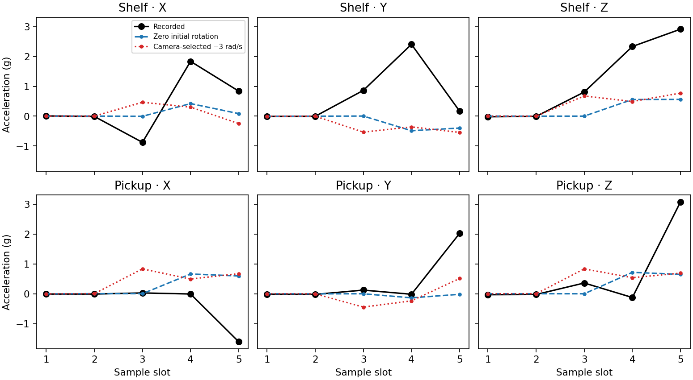
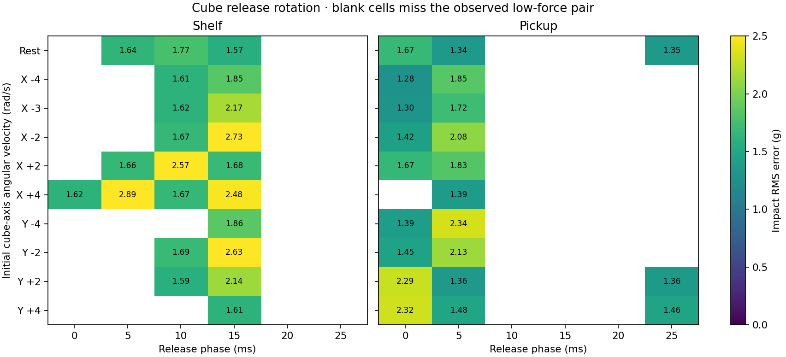

# Cube rotation at release, checked against camera travel and acceleration

A simulated release at **−3 rad/s about the cube's X axis** moved the cube center **11.51 mm horizontally in 200 ms**. The shelf camera’s primary estimate was 11.3–12.1 mm over about 196 ms. Zero initial rotation gave 9.47 mm. Matching the shelf travel still left an impact error above 1.6 g and did not consistently improve the independent pickup recording.

The test held the previous shelf-selected 3 mm clearance and −150 mm/s world-X velocity fixed. Each recording supplied its own starting gravity direction. The initial grid comprised zero rotation and ±2 and ±4 rad/s about each horizontal cube axis separately, each at six packet phases. The X-axis −2 and −4 rad/s settings bracketed the primary shelf travel at 11.22 and 12.16 mm. We then tested their midpoint on both recordings, selecting that rate using shelf travel alone. The actual angular velocity and yaw at release remain unknown. The camera windows span some time before and after release, and alternate pose reconstructions give different travel. The simulated accelerometer is at the cube center.

| Rotation | Shelf travel | Shelf impact RMS | Held-out pickup impact RMS |
|---|---:|---:|---:|
| Zero | 9.47 mm | 1.568 g | 1.344 g |
| −3 rad/s about X | 11.51 mm | 1.615 g | 1.297 g |

Each RMS in the table uses its most favorable phase that reproduces the two physical low-force slots. The error covers all three signed components of the following three slots. Phase matters to the inference. At the shared **5 ms pickup phase**, adding rotation increased error from 1.344 to 1.719 g. At **0 ms** it reduced error from 1.670 to 1.297 g. The shelf-selected phase of 15 ms missed the pickup's low-force pair under both models. These two recordings support treating release rotation as an unknown per event. They do not establish a default spin for the cube or a correction to rubber friction.





[All 120 scores](scores.csv) · [Camera reconstruction](../release-translation.md) · [Prior packet parity test](../packet-parity/README.md) · [Release replay](../browser_impact_slip.mjs)

Run the following from the shelf-roll-stop directory with web dependencies installed. Raw packet CSVs include the initial angular rates. Travel files report horizontal displacement of the cube center across 200 ms. score.py accepts the gzip files published here.

```sh
for run in shelf pickup; do
  VECTOR_PACKET_CSV="release-pitch/$run.csv" node browser_impact_slip.mjs "$run" --rotation-sweep
  VECTOR_PACKET_CSV="release-pitch/$run-mid.csv" node browser_impact_slip.mjs "$run" --rotation-sweep --camera-midpoint
  gzip -f "release-pitch/$run.csv" "release-pitch/$run-mid.csv"
done
python release-pitch/score.py
```
