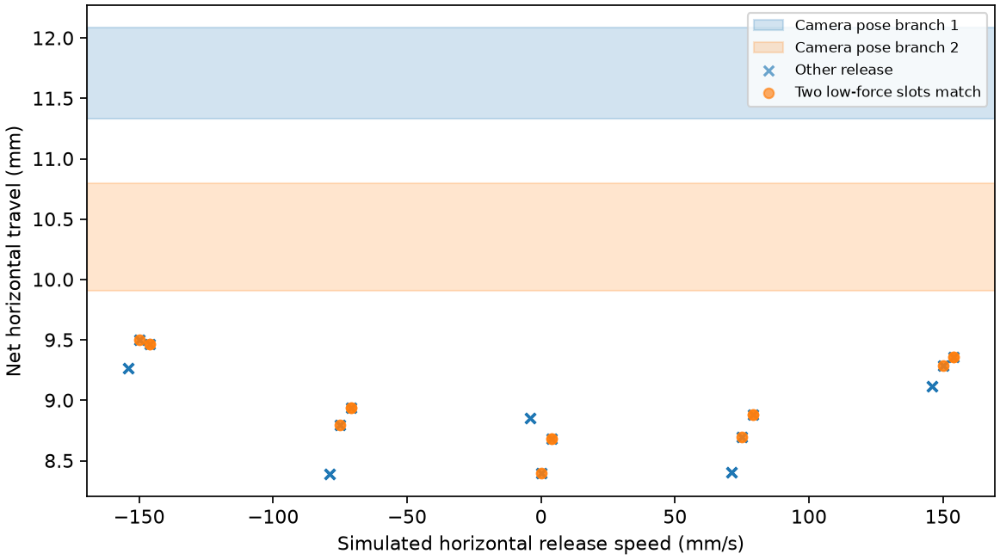
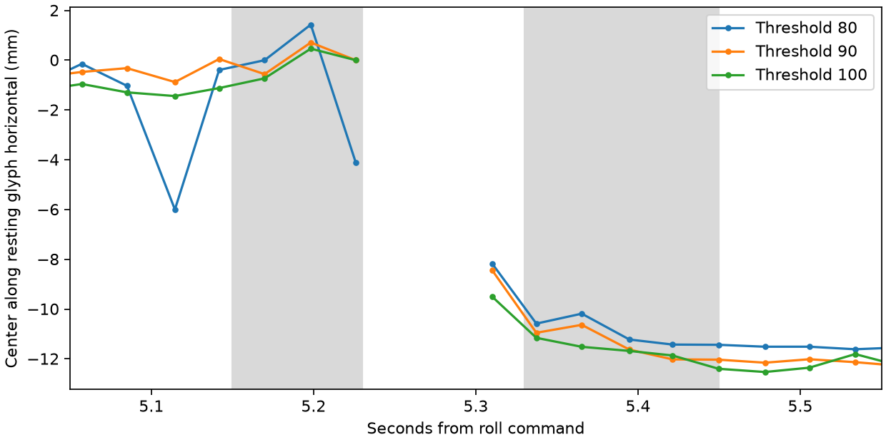

# Shelf camera constrains travel through the cube impact

The reconstructed cube center moved **11.3–12.1 mm along the shelf** between the last three held frames and five frames after landing. Almost all the displacement projects onto the horizontal axis of the upright glyph. A less accurate planar-pose solution gave 9.9–10.8 mm. The corresponding frozen browser releases moved **8.4–9.5 mm** among cases that also reproduced the two near-zero acceleration samples. Horizontal release speed within the tested range did not close both discrepancies.

For each corrected image we reconstructed the 23 mm glyph from four corners and carried the center 22 mm inward along its face normal. An upright reference glyph supplies the shelf normal. The pre- and post-impact centers are coordinate-wise medians from 5.15–5.23 s and 5.33–5.45 s after the roll command. Their median frame times are 196 ms apart. The primary range spans three image thresholds, ±5% focal variation and using either the before-roll or after-roll reference. It is a sensitivity range, not a statistical confidence interval. Dropping one image from either window widens the primary range to 11.0–16.1 mm; the alternate branch spans 9.7–19.9 mm under the same check.

The frame trace omits reconstructions with reprojection error above 0.4 pixels. The two frames at roughly 5.254 and 5.281 s were motion-blurred. The endpoint displacement gives an average of 58–62 mm/s over the interval on the primary solution. **The instantaneous release velocity remains unresolved.** In particular, the cube center moves horizontally as it rotates onto its face, even when dropped with zero initial horizontal velocity.

| Initial horizontal speed | Simulated 200 ms net travel for packet-matched cases |
|---:|---:|
| −150 mm/s | 9.47–9.50 mm |
| −75 mm/s | 8.80–8.94 mm |
| 0 mm/s | 8.40–8.68 mm |
| +75 mm/s | 8.70–8.88 mm |
| +150 mm/s | 9.29–9.36 mm |

The simulation uses the packet-matched cases from the [horizontal release sweep](browser-impact-slip.md). Comparison uses net planar distance because cube yaw relative to the camera is not registered here. The browser window starts exactly at modeled release; the camera median endpoints bracket physical release and may include fork-driven travel. Both pose branches and all individual-frame sensitivity results are available below.

[Camera reconstruction](release_translation.py) · [Camera sensitivities](release-translation.csv) · [Browser trajectories summarized by release](browser-release-travel.csv) · [Plot](release_travel_plot.py). Run the browser replay with `--travel` to reproduce the 90 simulated displacements.
