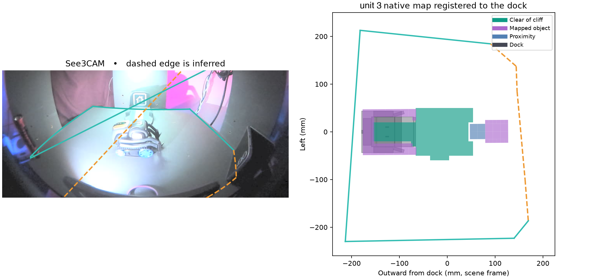
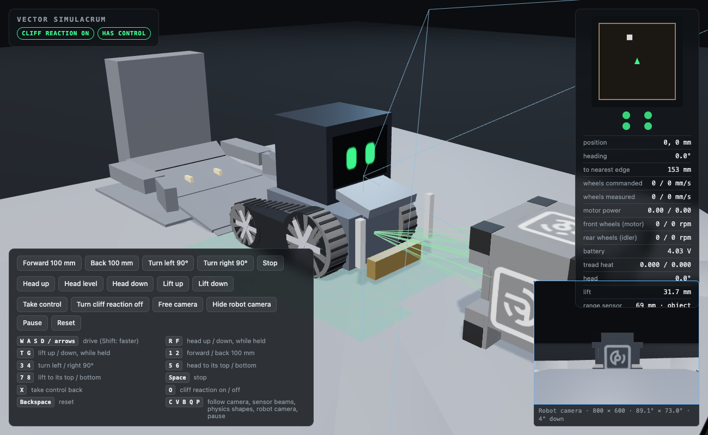
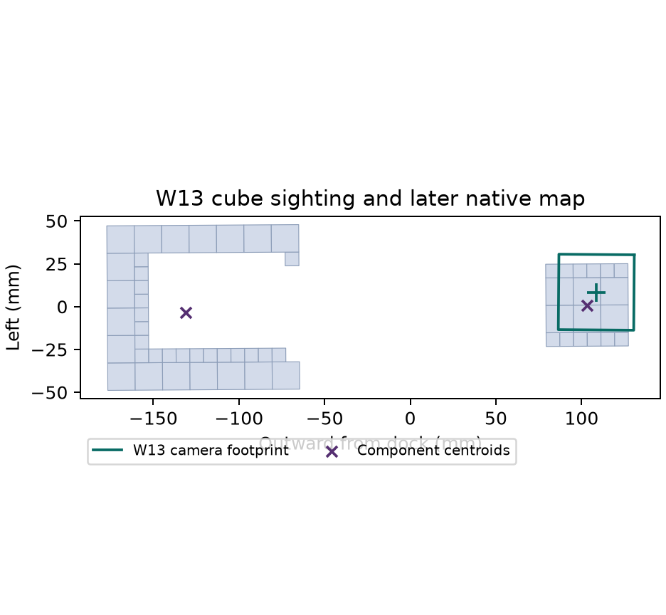

# unit 3 shelf and native map

The daughter pod subscribes to Vector's stock NavMap feed without requesting behavior control. Changes are stored transactionally in `/var/lib/vector-maps/p2-shelf/native.sqlite`. A fresh connection gets a new session identifier. A stationary robot on charging contacts registers that session and firmware origin to the modeled seated pose, 30 mm up the ramp. Unregistered revisions stay available for subsequent registration. A service restart recovered the earlier 27 revisions and added eight from the new connection. This tested an observer restart on origin 15. Robot reboot and physical dock relocation were not tested. A relocated dock requires a separate shelf map.

The checked-in browser snapshot contains 35 registered revisions and 157 ten-millimetre cells reported clear of cliffs. No cliff cell was reported in that snapshot. Proximity obstacles and the movable cube are retained in each raw revision and the latest registered view; only explicit floor and cliff observations contribute to the persistent terrain overlay. Seeing beyond an area establishes line of sight, not floor support. Green in the web view indicates observed support, red indicates a cliff and amber indicates conflicting observations. Empty areas have unknown native terrain status. Cell size describes raster resolution; dock seating and odometry also contribute registration error.

The physical scene uses an upright See3CAM frame and the earlier dock calibration. The visible rear span is about 44 cm. The lens and pose fit used the four exposed glyph corners with the older camera pose as a prior. The camera clips or obscures the near boundary; dashed segments in the overlay close the footprint provisionally. The mesh consists of triangular prisms and uses the existing model's shelf thickness and floor drop. Side walls and exact cutout dimensions still need measurement. The 13 dock surfaces come from the existing [dock simulacrum](https://github.com/P1R4N351/vector-simulacrum/commit/9fe68d402da730a93df90f2031c4e51e3f74546b). Its lip is 94 mm in front of the surveyed glyph. The shelf scene uses the dock's geometry; the simulator's electrical charging behavior is separate.

[W13's sighting](W13-registered.csv) uses eight same-origin SDK charger observations and the robot pose 2.45 ms from the cube sighting. The simulated chassis and free cube settle at that location. All four cliff beams hit the shelf. A ray just outside an angled edge hits the floor, and rays up the dock hit the apron and bed at different heights. W13 ended during acquisition, so it provides a placement check only.

## Reproduce

Open the web simulator with `?env=shelf&cubeSensor=unit3`. Use `&contact=42` for the 42 mm model or `&fork=printed` after running the existing printed-fork exporter. `?env=table` explicitly selects the older environment. For Python experiments use `VectorSim(environment="p2_shelf", cube="free")`. This starts the robot and cube on the shelf. To repeat the W13 check run `python evidence/unit3-wheelstand/shelf-scene/check.py` from the repository root. Use `PYTHONPATH=. python evidence/unit3-wheelstand/shelf-scene/plot.py` to reproduce the comparison.

The pod refreshes its dock-registered JSON every five minutes. On the lab workstation, `tools/p2_shelf/sync_preview.sh` copies it atomically to the local web server. Open the shelf scene with `&map=live` and reload for the latest export. The default URL uses the versioned snapshot so comparisons remain reproducible.

## Cube and charger in the native obstacle layer

The SDK calls content type 3 `ObstacleCube`. The firmware assigns its observable-object class to both light cubes and chargers, and marks the back and sides of the charger. The first overlay labelled both purple regions as cube. Its legend now says mapped object. [Firmware mapComponent.cpp](https://github.com/kercre123/victor/blob/669ec7499a7084640b57706a7937884a6568be50/engine/navMap/mapComponent.cpp#L96-L166)

Grouping edge-connected leaves before computing their area-weighted centres separates the dock-side region (37 leaves) from the cube-side region (18 leaves). The latter occupies 2,304 mm², equivalent to a 48 mm square. Its centre is 5.4 mm toward the dock and 7.5 mm to the right of the earlier W13 camera sighting, for a 9.25 mm separation. This compares estimates that share robot localization and were acquired at different times. It does not independently establish a physical cube offset. All four corners of each of the 157 native floor cells lie inside the surveyed footprint.

Reproduce with `PYTHONPATH=. python evidence/unit3-wheelstand/shelf-scene/cube_map_check.py`.
