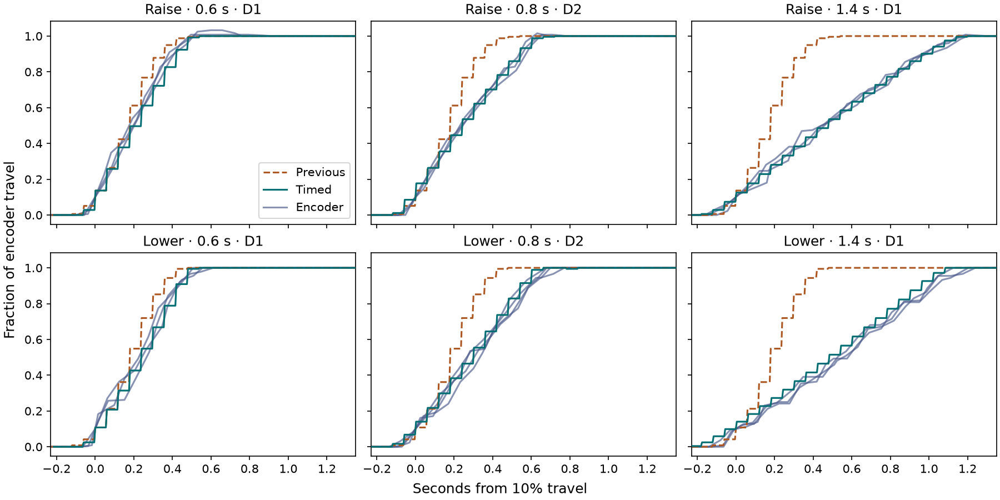

# SDK lift duration on the shelf

The robot supervisor's [SetLiftHeight handler](https://github.com/kercre123/victor/blob/snowboy/robot/supervisor/src/messages.cpp#L437) allocates 10% of the duration to each ramp. For a stroke starting at rest, the [velocity generator](https://github.com/kercre123/victor/blob/snowboy/robot/supervisor/src/velocityProfileGenerator.cpp#L249) therefore requests a cruise speed of angular travel divided by 0.9 times the duration. The simulator uses those speed and acceleration targets in its discrete servo controller. Zero duration retains the ordinary speed-driven action. Motion reversals during a stroke, loaded strokes, and durations that saturate the motor were outside this experiment.

We replayed the D1 full-range commands at 0.6 and 1.4 seconds and checked the same rule on the 0.8-second free-standing D2 recording. No parameter was fitted. Each line is normalized to its own encoder travel and aligned at 10% travel, so these plots test profile shape independently of command latency and endpoint calibration. D2 raise 2 had a five-second receipt gap and is excluded.

| Recording | Valid strokes | Previous mean absolute 10–90% time error | Timed mean absolute error | Timed strokes within 5% |
| --- | ---: | ---: | ---: | ---: |
| D1 on dock | 12 | 347 ms | 25 ms | 10/12 |
| D2 off dock | 7 | 210 ms | 28 ms | 3/7 |

The held-out simulated lower takes 542 ms through the central 80%. Hardware took 551–597 ms. This direction-dependent residual warrants testing under different loads. The previous and timed predictions use the same Vector 2 parameters, joint limits, sensor quantization and simulated SDK state cadence. The simulated robot stands on the table for all replays.

Run `PYTHONPATH=. python evidence/unit3-wheelstand/timed-lift/replay.py` at the repository root to regenerate the figure and per-stroke CSV.
