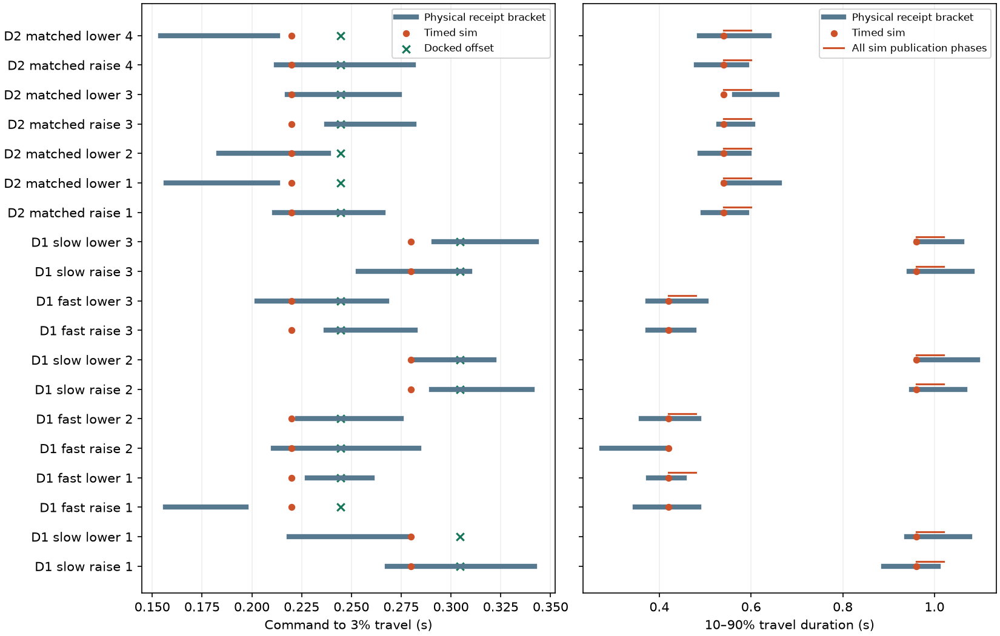

# SDK lift duration on the shelf

The robot supervisor's [SetLiftHeight handler](https://github.com/kercre123/victor/blob/snowboy/robot/supervisor/src/messages.cpp#L437) allocates 10% of the duration to each ramp. For a stroke starting at rest, the [velocity generator](https://github.com/kercre123/victor/blob/snowboy/robot/supervisor/src/velocityProfileGenerator.cpp#L249) therefore requests a cruise speed of angular travel divided by 0.9 times the duration. The simulator uses those speed and acceleration targets in its discrete servo controller. Zero duration retains the ordinary speed-driven action. Motion reversals during a stroke, loaded strokes, and durations that saturate the motor were outside this experiment.

We replayed the D1 full-range commands at 0.6 and 1.4 seconds and checked the same rule on the 0.8-second free-standing D2 recording. No parameter was fitted. Each line is normalized to its own encoder travel and aligned at 10% travel, so these plots test profile shape independently of command latency and endpoint calibration. D2 raise 2 had a five-second receipt gap and is excluded.

| Recording | Valid strokes | Previous mean absolute 10–90% time error | Timed mean absolute error | Timed strokes within 5% |
| --- | ---: | ---: | ---: | ---: |
| D1 on dock | 12 | 347 ms | 25 ms | 10/12 |
| D2 off dock | 7 | 210 ms | 28 ms | 3/7 |

The held-out simulated lower takes 542 ms through the central 80%. Hardware took 551–597 ms. This direction-dependent residual warrants testing under different loads. The previous and timed predictions use the same Vector 2 parameters, joint limits, sensor quantization and simulated SDK state cadence. The simulated robot stands on the table for all replays.

Run `PYTHONPATH=. python evidence/unit3-wheelstand/timed-lift/replay.py` at the repository root to regenerate the figure and per-stroke CSV.

### What the receipt cadence resolves

We bracketed each physical encoder threshold between the preceding receipt and the first receipt above it, on the host command clock. For central travel the shortest possible interval is the last receipt below 90% minus the first above 10%. The longest uses the opposite endpoints. These brackets describe the received signal. Unknown variable network latency also affects comparison to the physical joint.

The fixed-phase simulator gives 540 ms for all held-out 10–90% strokes when scored at the first published state over each threshold. Five of seven physical brackets contain 540 ms. The other two are lowers with lower bounds of 541 and 564 ms. Sampling the same quantized simulation at all relative phases of its 60 ms publication period gives either 540 or 600 ms. At least one of those two values falls inside every held-out physical bracket. The phase of each real command relative to publication was unmeasured. Each stroke's possible phase was tested independently. This limits what the recordings resolve about a directional mechanical error.

The 3% threshold (about 1.8 mm) provides a repeatable early-motion landmark. Adding the docked median offset of 24.6 ms to the simulated command-to-threshold time improved docked coverage from 4/12 to 10/12, but held-out coverage stayed at 4/7. We retained the existing command delay. Independent acquisition timestamps or higher-rate encoders would distinguish publication timing from actual actuator lag.

[Per-stroke brackets in seconds](receipt-timing.csv). Regenerate with `PYTHONPATH=. python evidence/unit3-wheelstand/timed-lift/receipt_timing.py`.
