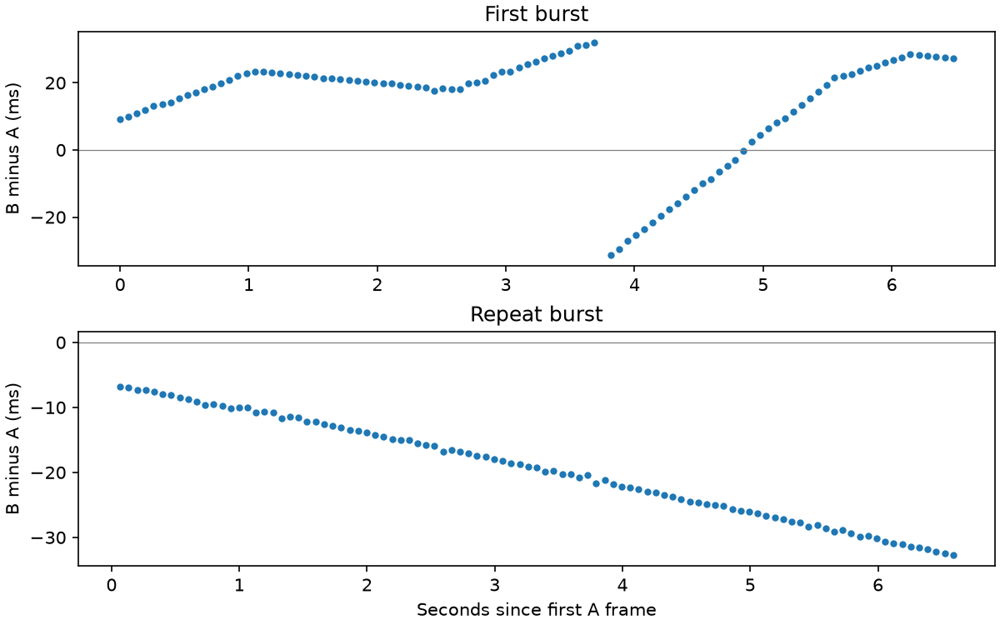
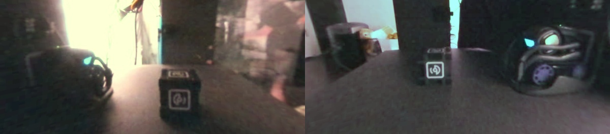

# Opposing shelf camera timing

Two independently started bursts from the opposed See3CAM_24CUG cameras on one host, with the robot stationary. Each process requested 1280×720 MJPEG at 30 fps, copied the V4L2 packet timestamps and recorded 100 packet checksums. A is the native-upright camera and B is the camera that requires a 180° display rotation. The framecrc time base is one microsecond. Sensor exposure midpoint and inter-camera exposure delay have not been measured.

| Burst | Actual average A / B (fps) | Mutual nearest pairs | Median absolute skew | 95th percentile | Maximum |
|---|---:|---:|---:|---:|---:|
| First | 15.28 / 15.09 | 99 | 20.70 ms | 29.51 ms | 32.12 ms |
| Repeat | 15.03 / 15.09 | 99 | 19.29 ms | 31.40 ms | 32.74 ms |

Use individual recorded timestamps when comparing moving landmarks. At 90°/s a 32 ms offset alone corresponds to nearly 3° of rotation. This is a timing example, not a measured cube speed. A common visible light transition would independently measure agreement in image content. These static bursts do not establish stereo geometry or hardware synchronization.

Capture both streams concurrently using the persistent device path for each camera, with `ffmpeg -copyts -f v4l2 -input_format mjpeg -video_size 1280x720 -framerate 30 -i DEVICE -frames:v 100 -c:v copy -f framecrc OUTPUT`. Run `python compare.py` to reproduce the plot from the four packet logs.

### Visible timing check with the cube LEDs

With the cube centered, both cameras recorded three green pulses, including all three falling edges. The battery-powered cube was driven briefly from the camera host over its BLE application light characteristic and left dark, then disconnected. The shelf lamp was untouched. We used the first pulse to locate the strongest local increase in green relative to red and blue in each image, then scored all three pulses at those fixed locations. For each transition, the last frame on one side of half brightness and the first frame on the other side bracket the visible change. All six pairs of camera brackets overlapped. B-minus-A midpoint differences ranged from −23.8 to +47.6 ms, so a constant correction inferred from this run is unwarranted. Frames are free-running, and command acknowledgement is only the plotting origin.

[Three pulses on both cameras](cube-led-pulses.png) · [Six edge brackets](cube-led-edges.csv) · [Analysis script](cube_pulses.py)

### Default inspection view for the opposed cameras

Use `python live_view.py HOST preview.jpg` for a fresh upright pair. Routine visual inspection, LED pulse extraction and glyph tracking use the same shelf view. Use the original recordings explicitly for optical calibration or diagnosis. Preserve source timestamps. The 1280×720 camera inputs are mapped to a 1000×440 rectilinear shelf view with a downward virtual pitch and ceiling crop. The second camera is rotated 180°. Color gains come from a bare shelf patch in the reference frame and stay fixed throughout a clip. A fixed midtone lift brings out shaded features. Avoid temporal smoothing when timing impacts or LED edges.

The equidistant focal length transfers the earlier single-camera shelf estimate at the new resolution. It is an approximate viewing correction. Absolute distance and stereo pose need separate calibration of the two mounted lenses. The shelf is a relative neutral reference; these views have no color-chart calibration. Refresh the reference after a lighting or camera change and confirm the patch still shows bare shelf.

We reran the three-pulse test through the corrected view. All six edge brackets agree with the earlier scoring. In the four LED-off windows the 95th-percentile apparent motion of stationary glyph corners ranged from 1.03 to 1.71 corrected pixels on A and 0.20 to 0.30 on B. With the LEDs on, A lost all 60 attempted corner matches under a one-pixel round-trip consistency check. B retained all 56. Use lit corners for timing and unlit glyphs for position on A. Neither pixel result measures millimetres or establishes accuracy on moving targets.

[Glyph landmarks and residuals](glyph-tracking.png) · [Per-frame scores](glyph-tracking.csv) · [Analysis](glyph_tracking.py)
