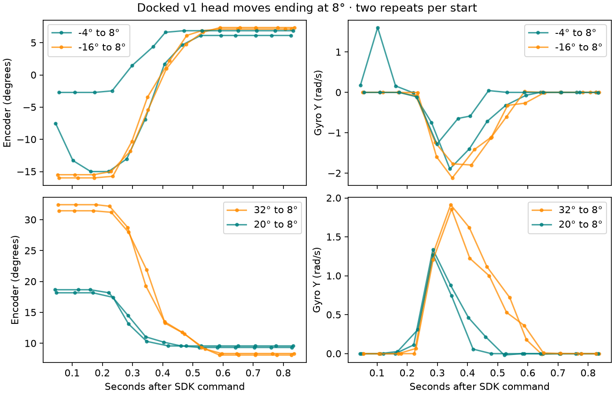

# Docked v1 head moves ending at 8°

Eight interleaved trials on one workshop v1. The robot held behavior override, stayed on its platform, and returned to its initial head angle. Both reported wheel speeds were zero in all 480 SDK states. The second v1 was unreachable. An active charging cycle was not reported at handback.

All four nominal 12° moves fell short of 90% of the distance from the measured starting angle to the 8° target within the 850 ms scoring window. All four nominal 24° moves crossed 90%. Their interpolated 10–90% transit was 212–237 ms raising and 237–240 ms lowering. Every final encoder reading retained a signed offset toward its starting side. This is a reason to score final angle separately from speed in short moves. Two repeats per condition on one unit do not establish the mechanism.

The SDK command and receipt timestamps use one host monotonic clock. Median state spacing was 60.3 ms. The gyro peaks are sampled values. A missing threshold crossing is recorded as NaN. The figure shows command-aligned observations. Run analyze.py alongside states.csv with NumPy and Matplotlib to reproduce it and moves.csv.
