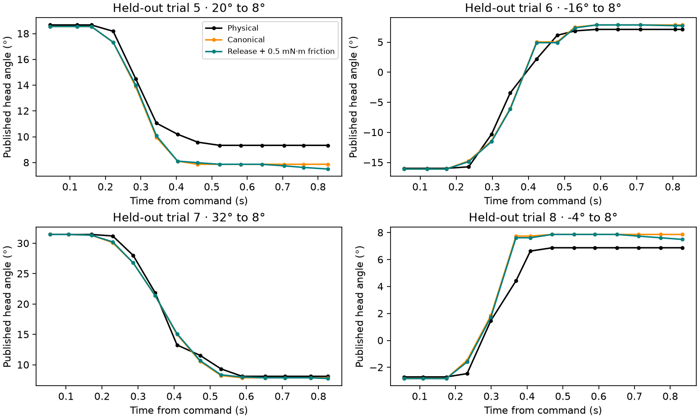

# Holding the docked head after motor release

Adding friction to the head hinge prevented the large simulated drop seen when the head actuator was released. It did **not** reproduce the physical approach-dependent endpoint at 8°. The tested coefficient is a simulated Coulomb friction torque, not a measured gearbox property.



We added joint friction for the entire move, including the powered approach, before creating the MuJoCo model. For release we zeroed the head actuator gain and bias when it reported in-position at the requested target. The first repeat from each of four starting angles was used for selection. The other four trials were held out. Endpoint is the last published angle sampled within 850 ms after the command. Gyro RMSE equally weights the moves using all sampled times in the window.

* On the first repeats the smallest tested torque attaining the minimum endpoint error was **0.5 mN·m**. At 0.4 mN·m the error was 2.05°, at 0.5 it was 1.14°, and every larger tested value through 12 mN·m tied it.
* On held-out repeats, release without friction had 18.86° endpoint MAE. With 0.5 mN·m it fell to **0.86°**, the same as canonical. The best first-repeat gyro RMSE selected 6 mN·m. With that value, held-out gyro RMSE was **0.150 rad/s**, versus 0.185 canonical. Its endpoint error was also 0.86°.
* On eight independent archived docked movements to −8° and +22° at two lift postures, 6 mN·m gave 0.143° endpoint MAE and 0.343 rad/s gyro RMSE, versus 0.158° and 0.358 rad/s canonical. All eight simulated moves reached release. The improvement is small compared to SDK sampling and registration uncertainty. Each replay starts at the measured pre-command head angle and, for this archive, measured lift height.

This establishes a way to hold the simulated head through the sampled interval after release. Multiple torques explain those endpoints equally well, and the physical recordings do not measure motor power. The canonical defaults were retained. [All grid scores](friction-scores.csv) · [Independent recording scores](posture-friction-scores.csv)

To reproduce in this directory with the web dependencies installed:

```sh
node replay.mjs
for t in 0 0.05 0.1 0.2 0.3 0.4 0.5 1 2 3 4 6 8 12; do
  node replay.mjs --release --friction-mNm="$t"
done
node replay.mjs --posture
for t in 0.5 6; do node replay.mjs --posture --release --friction-mNm="$t"; done
python friction_sweep.py
```
