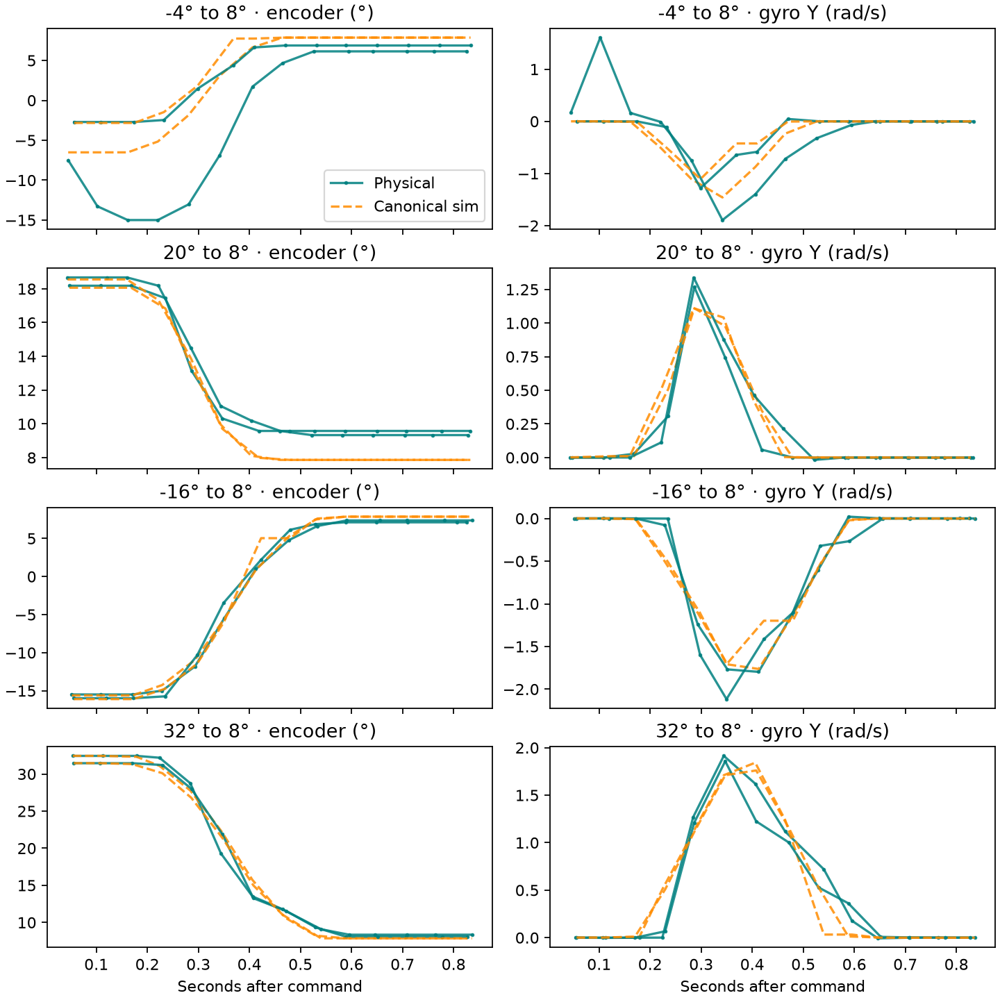

# Docked v1 head endpoint replay

The canonical v1 model reaches the same published 7.86° for all eight commands to 8°. The physical head retains an offset toward its starting side in all eight. The last sampled angle differs from the simulator by 1.47° mean absolute error on the nominal 12° moves and 0.49° on the nominal 24° moves. The physical encoder and gyro show an additional reversal on the first raise. From −6.39° at the cue the encoder initially drops to −15.00°, then rises to +6.14°. The other raise from the same nominal starting position shows no such dip. The recording does not identify its cause.

Each trial independently initializes the canonical docked model at the last measured angle before the command, settles it for 600 ms, then sends the target. The lift uses its default initial height because this capture omitted lift telemetry. Simulated SDK states are sampled at the physical host receipt times through 850 ms. The two SDK publication clocks are independent. No delay or endpoint was fitted. [Per-move errors](endpoint-errors.csv)

The stock head controller zeroes power after staying within tolerance for over 200 ms at its final command. As a diagnostic, we disabled the MuJoCo head actuator's gain and bias upon the corresponding in-position transition. The unloaded joint sagged and the mean absolute endpoint error rose from 0.98° to 18.30°. Simply removing actuator force therefore fails this docked test. Passive gearbox holding torque is a candidate for a separate measurement. [Stock head controller](https://github.com/os-vector/wire-os-victor/blob/3cec4844d24c4719b5b3892e4979494bcd260424/robot/supervisor/src/headController.cpp#L683)

Run `node replay.mjs`, `node replay.mjs --release`, and `python score_replay.py` here with the web dependencies, NumPy and Matplotlib installed. Both simulations use the common canonical docked XML at commit 6f38365. No production parameters changed.
