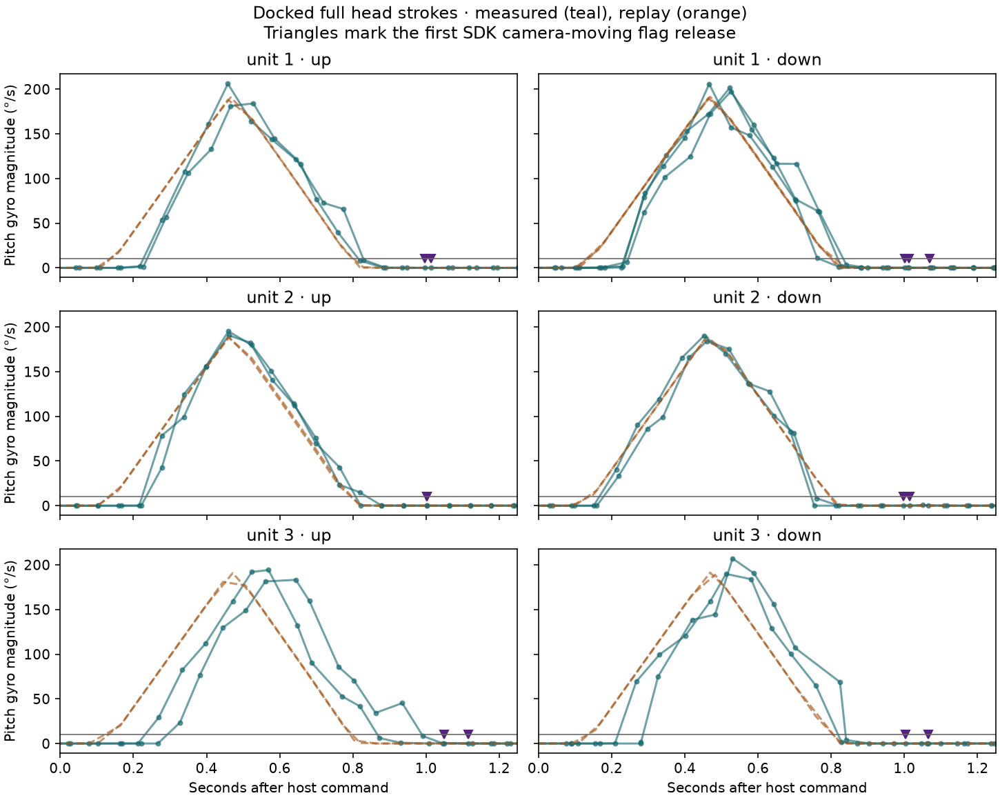

# Docked head motion and the vision gates

The gyro threshold and the camera-moving status are separate firmware checks. The marker detector uses bracketing IMU samples and a 10°/s head threshold. Later the object tracker consults both present and historical movement state. The present state combines a cleared HEAD_IN_POS bit (0x200) with ARE_WHEELS_MOVING (0x8000) using logical OR. The stock controller requires more than 200 ms continuously inside angular tolerance after its commanded profile has reached the target before setting HEAD_IN_POS.

| Docked robot | Full strokes | Measured minus replay onset, median | Measured minus replay clearance, median | Status release after measured gyro clearance, median sample brackets |
|---|---:|---:|---:|---:|
| unit 1 (unit 1) | 5 | +122 ms | 0 ms | 150–212 ms |
| unit 2 (unit 2) | 4 | +87 ms | −30 ms | 179–239 ms |
| unit 3 (unit 3) | 4 | +140 ms | +60 ms | 155–207 ms |

We used the previously accepted full docked raises and lowers and each move's measured starting posture. The MuJoCo actuator replay uses the existing level-table parameters, including the existing command delay. The plot uses SDK receipt time. Gyro onset and clearance use midpoints between SDK samples around the first and last pitch magnitudes above 10°/s. The model is sampled at the same times. Each status release is bracketed by the last moving sample and first clear sample. The table gives the medians of the bracket endpoints. Four SDK samples across all windows have the wheel-moving bit set. The CSV includes that count per move. Sampling is approximately 60 ms. Subsample crossing times and the state at the exact exposure instant remain unresolved.

All 13 physical moves cross 10°/s later than their matched replays. Clearance discrepancies differ by robot and direction. On unit 3 they span 0 to 181 ms. These runs support a real interval in which the gyro permits detection while camera-moving status can still suppress a world observation. They do not establish what caused the particular live simulated rejection. Independent engine processing latency, historical movement queries and uncommanded movements during wake-up are outside the replay.

[Per-stroke measurements](moves.csv) · [Reproduction script](compare.py) · [Stock head controller](https://github.com/os-vector/wire-os-victor/blob/3cec4844d24c4719b5b3892e4979494bcd260424/robot/supervisor/src/headController.cpp) · [Movement status](https://github.com/os-vector/wire-os-victor/blob/3cec4844d24c4719b5b3892e4979494bcd260424/engine/components/movementComponent.cpp)
