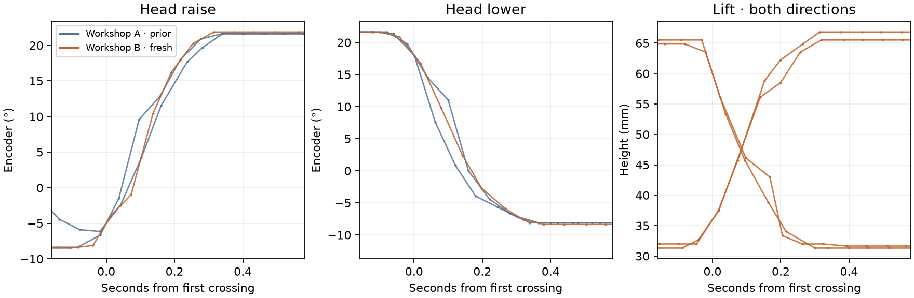

# Workshop joint timing on the dock

Workshop B contributed 421 passive reports and 254 reports under SDK override. The dock flag was set in every report. The battery read 3.549 V, on platform, charging inactive, before and after each recording. Both wheel speeds were zero throughout passive capture. During joint commands the largest absolute wheel report was 1 mm/s. There were no wheel commands. Workshop A was unreachable for this session. Its curves are from the earlier lift-down trials in [the paired dock experiment](../docked-head-20261126/lift-posture/README.md).

Workshop B executed two head cycles between −8° and +22° and two lift cycles between lowered and 0.55 normalized height. Timing uses linear interpolation of SDK receipt timestamps. Only one raise and one lower bracketed both head thresholds inside their command windows. Their −5° to +18° transits took 219 and 247 ms respectively. The other two moves were already past the first threshold at the start of their windows. The earlier workshop A raises took 218 and 244 ms and lowers took 219 and 236 ms. The 11 ms difference between B’s lower and A’s slowest lower is smaller than a typical SDK reporting interval (about 60 ms).

Workshop B crossed 36 to 60 mm in 169 and 217 ms and crossed back in 194 and 195 ms. The return command used the head angle sampled after control acquisition (−15.24°). The final encoder reading was −13.52°. The passive run before control acquisition measured −21.14°. These are unloaded measurements on one docked robot.

Run `python analyze.py ../docked-head-20261126/lift-posture/active.csv` from this folder with NumPy and Matplotlib installed. [Joint recording](joints.csv) · [Rest recording](rest.csv) · [Transit times](transits.csv). Gyro is in rad/s, acceleration in mm/s², wheel speeds in mm/s. Each recording has its own monotonic time origin.
