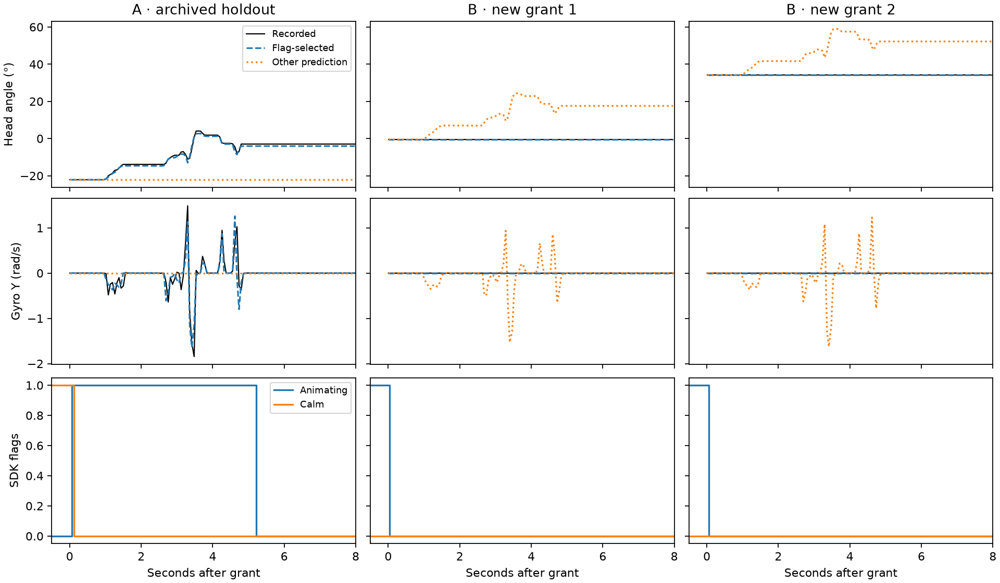

# Predicting head motion from the last calm flag before SDK override

In two prospective eight-second recordings, workshop B granted override while already out of calm mode. The encoder stayed at −0.50° in the first and +34.16° in the second, despite the different starting postures. Each grant contained 134 SDK reports. Absolute gyro Y remained below 0.0018 rad/s. The robot was on the platform before and after each capture. No actuator commands were issued.

Before collecting the new traces, we fixed a selector. Read the calm-mode bit in the final SDK packet before grant acknowledgment. If set, add workshop A's previously fitted [two-session mean displacement](../../docked-head-20261126/grants/transfer.md) to the final measured head angle and gyro. If clear, keep the last readings constant. Both predictions use only information available at grant. Selection is based on an observed input; this experiment does not predict whether the robot enters calm mode.

| Eight-second recording | Calm before grant | Measured head range | Selected angle RMS | Selected gyro RMS |
|---|---|---:|---:|---:|
| A, archived held-out grant | Yes | 26.17° | 0.92° | 0.165 rad/s |
| B, first new grant | No | 0.00° | 0.00° | 0.00060 rad/s |
| B, second new grant | No | 0.00° | 0.00° | 0.00087 rad/s |

Applying the moving waveform to every grant would miss B's head position by 15.23° and 15.24° RMS. Holding every starting angle constant misses A by 16.01° RMS. A's outcome was already known when the selector was proposed. B's outcomes are new. Also, robot identity and calm state coincide in these validation cases. Observing the opposite state on either robot is needed to distinguish the flag from robot-specific behavior. No default motion was added to the simulator.

[Machine-readable scores](scores.csv) · [Capture](capture_blind.py) · [Analysis](score.py). Run score.py with NumPy and Matplotlib to regenerate the figure and both scoring windows. The reference clock is host receipt time. The two new raw packet streams are in this directory.
