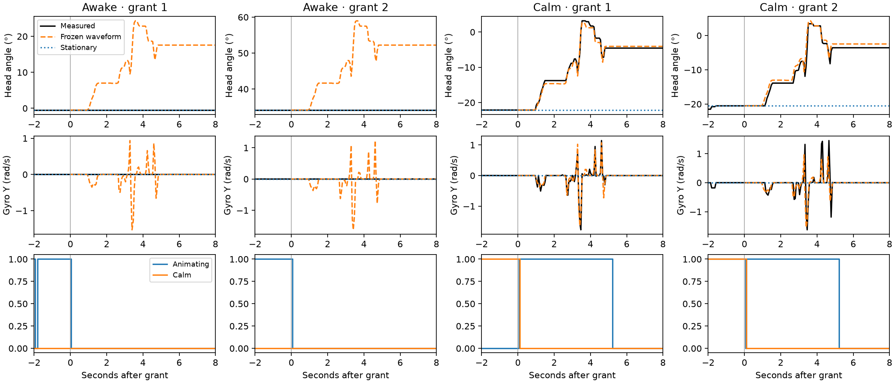

# Same robot, different head response to docked SDK control

The same workshop Vector stayed still for two awake grants and moved its head through 25.31° and 23.96° for two grants from calm mode. Both new recordings began after the native sleep intent. A passive SDK connection observed at least three seconds of calm on the dock before requesting override. The final packet before each grant confirmed calm. No head, lift or wheel commands were issued. Both sessions ended on the charging platform at 3.549 V.

Dashed orange uses the displacement learned from two earlier grants on the *other* workshop Vector, anchored at the last pre-grant encoder and gyro readings. The dotted line holds those starting readings constant. No amplitude adjustment, time shift or retraining used the new robot's response.

| Starting condition | Measured head range | Stationary angle RMS | Waveform angle RMS | Stationary gyro RMS | Waveform gyro RMS |
|---|---:|---:|---:|---:|---:|
| Awake, first | 0.00° | 0.00° | 15.23° | 0.00060 rad/s | 0.253 rad/s |
| Awake, second | 0.00° | 0.00° | 15.24° | 0.00087 rad/s | 0.289 rad/s |
| Calm, first | 25.31° | 15.32° | 0.71° | 0.285 rad/s | 0.109 rad/s |
| Calm, second | 23.96° | 14.37° | 1.26° | 0.333 rad/s | 0.261 rad/s |

Each row covers 134 SDK packets over eight seconds. In the calm trials the animating flag first appeared 45–51 ms after grant and was last seen at 5.15–5.16 s. Gyro Y first exceeded 0.1 rad/s in magnitude at 1.01 and 1.19 s. Timing uses host receipt timestamps.

This crossover removes robot identity as an explanation for the awake/calm split. Sleep also changes starting head angle and other firmware state. The calm flag predicts the outcome in these runs, but manipulating the flag alone has not been tested. The data support modeling a docked wake movement on override when the robot starts in calm mode. Interaction with competing head commands and generalization to Vector 2.0 remain unverified.

[Per-run scores](crossover-scores.csv) · [Frozen prediction and awake captures](README.md) · [Calm capture](capture_calm.py) · [Reproduction](cross.py). Run cross.py with NumPy and Matplotlib in this checkout.
