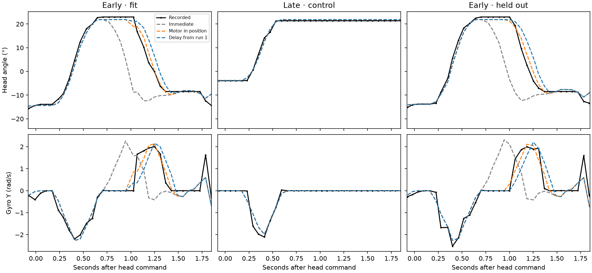

# Head reversal during docked wake

The canonical simulated head gives control back to the wake animation too early. On the first early raise its action ends 2.045 s after grant, when the joint first enters angle tolerance. The physical SDK reports success at 2.391 s. The simulated gyro begins sustained downward motion at approximately 2.239 s, while the physical gyro begins at 2.547 s. The repeat shows the same ordering. Reversal time is the midpoint of the receipt interval leading into two consecutive gyro Y samples above +0.30 rad/s after the raise. The SDK samples roughly every 60 ms.

We tested the simulator's existing motor-in-position flag as a separate condition for resuming the animation. That flag requires the accepted target to reach the controller and the measured angle to stay within tolerance for over 200 ms. The physical status packets also first show head-in-position at 2.329 and 2.327 s on the early raises, before the SDK success responses and the later gyro reversals. The replay uses the simulated flag only. No physical status transition is injected.

| Held-out early raise | Immediate resume | Wait for simulated in-position | Fixed pause learned on run 1 |
|---|---:|---:|---:|
| Angle RMS during handoff | 16.03° | 2.43° | 5.61° |
| Gyro RMS during handoff | 1.615 rad/s | 0.362 rad/s | 0.625 rad/s |
| Angle RMS over eight seconds | 4.66° | 1.35° | 1.93° |
| Gyro RMS over eight seconds | 0.510 rad/s | 0.207 rad/s | 0.249 rad/s |

The fixed pause was the 308 ms reversal-time difference measured on the first early raise. It brings the reversal into the same SDK interval on the repeat, but the trajectory through the reversal is less accurate than with the existing in-position signal. The signal-based result still reverses about one packet early. For the late raise, all three rules give identical predictions because the wake animation has already ended.

This experiment changes the time at which the animation can regain the head. The SDK-shaped action itself still reports success on reaching angle tolerance. Its completion remains early in the simulator. The 200 ms preview of the stored wake curve, motors, IMU and all other settings remain frozen from the [motor replay](motor-replay.md). Handoff scores cover 0.9–1.5 s after the head command. The validation is limited to one held-out repeat on this docked v1 robot.

[Scores](handoff-scores.csv) · [Reproducer](handoff.mjs). Install the web dependencies, run handoff.mjs with Node and run handoff_plot.py with NumPy and Matplotlib.
